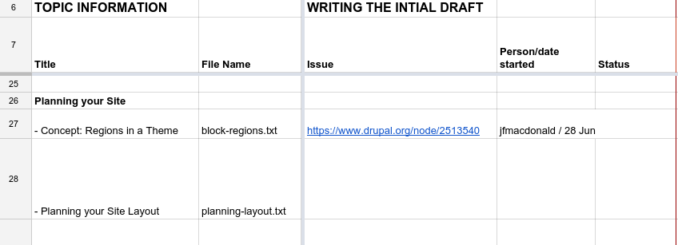
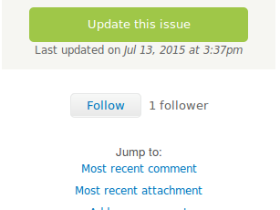

# Practicalities of Contributing

Quick start guides and details for contributors to the Drupal User Guide.

Thank you for your desire to help us create a great Drupal User Guide! The
sections below contain information you’ll need, in order to contribute
your time and skills to this project. Start with:

- [Quick start guide - writing tasks](#practicalities-writing-phase) if
  you want to write the first draft of a topic

- [Quick start guide - editing tasks](#practicalities-editing-by-task)
  if you want to do some editing

- [Quick start guide - translating tasks](#practicalities-translating)
  if you want to help translating it to a different language

## Quick start guide - writing tasks

Here is an abbreviated guide to writing the first draft of a topic for
the Drupal User Guide project.

**Note: Several links may require a user name / password for the browser
- this is `drupal` / `drupal`.**

**Note: If you contribute your writing to this project, you agree that
it will be licensed with [CC BY-SA
2.0](https://creativecommons.org/licenses/by-sa/2.0/). See [Copyright and
License](./copyright-license.md#copyright-license) for details.**

1.  **Find a topic** that you can write within about two weeks, and
    locate its issue. See [Detailed instructions: Finding a topic to
    write and locating its issue](#practicalities-find-topic) for
    details on how to do this.

2.  **Claim the task** by assigning the issue to yourself. See [Detailed
    instructions: Claiming and dropping
    tasks](#practicalities-task-claim) for details.

3.  **Write** your topic:

    - See [Detailed instructions: Viewing output and editing source
      files](#practicalities-editing) for details on how to find and
      edit files.

    - See [Formatting Your Text](./formatting.md#formatting) for
      details on how to format the text in files.

    - See [Detailed instructions: Deciding what to
      write](#practicalities-composing) for suggestions on deciding what
      to write.

    - See [Writing Good Documentation](./good-writing.md#good-writing)
      and [Style Guide for the Writing
      Phase](./guidelines-writing.md#guidelines-writing) for guidelines
      on how to write it, as well as [Following the
      Scenario](./follow-scenario.md#follow-scenario) (especially if
      you are writing a task topic).

    - If you need a **Drupal site to work with** (to try your task
      steps), you can make a temporary site at
      [simplytest.me](https://simplytest.me). Enter *drupal* as the
      project, and choose the version you want to use. The site will
      stay available for 24 hours.

4.  **Submit your work** to the issue. See [Detailed instructions:
    Submitting your writing or editing](#practicalities-submitting) for
    details.

5.  **Add copyright attributions information** to a comment on your
    issue. See [Copyright and
    License](./copyright-license.md#copyright-license) for details.

6.  Make sure you get recognized for your work. See [Detailed
    instructions: Getting recognition for your
    contribution](#practicalities-recognition) for details.

7.  Update the status of your issue (in the Issue metadata section) to
    ***Needs review***, and save.

8.  **Subscribe to email updates for your issue**. See [Detailed
    instructions: Subscribing to email issue
    updates](#practicalities-subscribe) for details.

9.  **Check on the status** of your issue until your change is
    *committed* (added to the source file repository), and marked
    *Fixed*. You may be asked to make a few changes before this happens.

10. If you find that you **cannot complete this task**, see [Detailed
    instructions: Claiming and dropping
    tasks](#practicalities-task-claim) for instructions on how to drop a
    task, and try again with a different topic.

11. If you have more time, follow these steps again to write a new
    topic.

See also: [Communication
channels](./management.md#management-channels) to keep up with project
announcements.

## Quick start guide - editing tasks

During this editing phase of the project, the project managers will set
up various editing tasks for volunteers to complete. To contribute to
this phase:

1.  **Find a task** by looking in the [Issues page for the User Guide
    project](https://www.drupal.org/project/issues/user_guide) for an issue
    whose title starts with "Guidelines Edit", "Copy Edit" or "Content
    edit", and whose *Assigned* field is blank. Do not choose a
    single-topic copy editing task for a topic that you wrote, however,
    since it is never a good idea to copy edit your own writing.

2.  **Claim the task** by assigning the issue to yourself. See [Detailed
    instructions: Claiming and dropping
    tasks](#practicalities-task-claim) for details on how to do this.

3.  **Complete the editing task** detailed in the issue, by editing
    source files on your local computer. Make sure to **only make edits
    that are covered by the guideline or task in your issue** — other
    issues will cover other tasks. See:

    - [Detailed instructions: Background on Drupal.org projects, Git,
      and patches](#practicalities-project) for details on how to obtain
      the source files from the Git revision control system (this is
      optional if your editing task only affects one file, and you
      choose to edit using the on-line editor).

    - [Detailed instructions: Viewing output and editing source
      files](#practicalities-editing) for details on how to find and
      edit files, either on your local computer (if you obtained the
      source files from Git) or using the on-line editor.

    - [Formatting Your Text](./formatting.md#formatting) for details on
      how to format the text in files.

4.  Make a *patch file* with your changes; however, if your task only
    affects a single source file, you can skip making a patch. See
    [Detailed instructions: Background on Drupal.org projects, Git, and
    patches](#practicalities-project) for patch file instructions if you
    need to make a patch.

5.  **Submit your work** to the issue. See [Detailed instructions:
    Submitting your writing or editing](#practicalities-submitting) for
    details.

6.  **Add copyright attributions information** in a comment on your
    issue. See [Copyright and
    License](./copyright-license.md#copyright-license) for details.

7.  Make sure you get recognized for your work. See [Detailed
    instructions: Getting recognition for your
    contribution](#practicalities-recognition) for details.

8.  Update the status of your issue (in the Issue metadata section) to
    ***Needs review***, and save.

9.  **Subscribe to email updates for your issue**. See [Detailed
    instructions: Subscribing to email issue
    updates](#practicalities-subscribe) for details.

10. **Check on the status** of your issue until your change is
    "committed" (added to the source file repository), and marked
    *Fixed*. You may be asked to make a few changes before this happens.

11. If you find that you **cannot complete this task**, see [Detailed
    instructions: Claiming and dropping
    tasks](#practicalities-task-claim) for instructions on how to drop a
    task, and try again with a different topic.

12. If you have more time, follow these steps again to complete another
    editing task.

## Quick start guide - translating tasks

Assumptions for this section:

- The Drupal User Guide is currently being translated from English into your
  language (that is, translation has started, and has not been
  completed).

- You have already contacted and joined the team that is translating the
  Drupal User Guide into your language. These translation teams are formed
  from the software localization teams on
  [localize.drupal.org](https://localize.drupal.org).

Steps to translate a topic or review a translation:

1.  **Find a task** by looking in the [Issues page for the User Guide
    project](https://www.drupal.org/project/issues/user_guide) for an open
    issue whose title starts with "\[LC\] Translate ", where "\[LC\]" is
    the two-letter code for your language. You can also filter the issue
    list by *Component* — there should be a component for your language
    in the list. If you want to translate a topic, look for an issue
    whose *Status* field says *Active*. If you want to review a
    translation, look for an issue whose *Status* field says *Needs
    review*.

2.  **Claim the task** by assigning the issue to yourself. See [Detailed
    instructions: Claiming and dropping
    tasks](#practicalities-task-claim) for details on how to do this.

3.  **Complete the translating or reviewing task**. You will need to
    edit the Markdown source files on your local computer,
    making sure to preserve the topic structure, frontmatter fields,
    links, anchors, and embedded media patterns. See:

    - [Detailed instructions: Background on Drupal.org projects, Git,
      and patches](#practicalities-project) for details on how to obtain
      the source files from the Git revision control system (this is
      optional for the initial translation, if you choose to edit using
      the on-line editor).

    - [Detailed instructions: Viewing output and editing source
      files](#practicalities-editing) for details on how to find and
      edit files, either on your local computer (if you obtained the
      source files from Git) or using the on-line editor.

    - [Formatting Your Text](./formatting.md#formatting) for details on
      the Markdown formatting used in the source files.

    - [Translation
      Guidelines](./guidelines-translating.md#guidelines-translating)
      for general guidelines on translating.

    - Your language team’s glossary, for guidelines on how to translate
      specific terms consistently in the Drupal User Guide.

4.  Make a *patch file* or *interdiff file* with your changes; however,
    if you are doing the initial translation, you can skip making a
    patch. See [Detailed instructions: Background on Drupal.org
    projects, Git, and patches](#practicalities-project) for patch and
    interdiff file instructions.

5.  **Submit your work** to the issue. See [Detailed instructions:
    Submitting your writing or editing](#practicalities-submitting) for
    details.

6.  Check over the **screenshot images** in your topic. They should
    match the instructions and descriptions, be well cropped, and not
    contain any English text (except, for instance, if the topic is
    about translating from English into your language). If there are any
    problems, note them in a comment on your issue. If they are fine,
    note that you checked them over and thought they were fine.

7.  **Add copyright attributions information** in a comment on your
    issue. See [Copyright and
    License](./copyright-license.md#copyright-license) for details.

8.  Make sure you get recognized for your work. See [Detailed
    instructions: Getting recognition for your
    contribution](#practicalities-recognition) for details.

9.  Update the status of your issue (in the Issue metadata section) to
    ***Needs review***, for the initial translation. If you are
    reviewing a translation, you have the choice of either:

    - Setting the status to *Needs work*, if you feel that the initial
      translator should make another attempt.

    - Setting the status to *Reviewed and tested by the community*, if
      you feel that the translation was good. Also, you can upload a new
      patch and an interdiff file, with small revisions and edits, if
      those are needed.

10. Save the issue comment and status update.

11. **Subscribe to email updates for your issue**. See [Detailed
    instructions: Subscribing to email issue
    updates](#practicalities-subscribe) for details.

12. **Check on the status** of your issue until your change is
    "committed" (added to the source file repository), and marked
    *Fixed*. You may be asked to make a few changes before this happens.

13. If you find that you **cannot complete this task**, see [Detailed
    instructions: Claiming and dropping
    tasks](#practicalities-task-claim) for instructions on how to drop a
    task, and try again with a different topic.

14. If you have more time, follow these steps again to complete another
    translating or reviewing task.

## Detailed instructions: Finding a topic to write and locating its issue

For the writing phase, we have a [tracking spreadsheet for the
topics](https://docs.google.com/spreadsheets/d/1ov0FyJhKrJe7PYvohzV5UrrLyRaVCy2A0BjjEatqxKw/edit?usp=sharing).
This lists
all of the topics that need to be written, along with their status, and
a link to the issue for the writing task. You’ll need to pick a topic
that hasn’t yet been written, and that no one else is currently working
on.

Some notes about the topic tracking spreadsheet:

- The topics are listed, one per row in the spreadsheet, within the
  outline of the Drupal User Guide. The left section of the sheet shows the
  topic names and what they are supposed to cover.

- You’ll want to find a topic that interests you, that you feel
  comfortable writing, and doesn’t already have a person listed as
  working on it. For instance, in the screen shot above, the "Planning
  your Site Layout" needs someone to write it, but "Concept: Regions in
  a Theme" is already being worked on by someone else.

If after looking through the topic spreadsheet, you still need help
finding a topic to work on, see [Project Coordination and
Communication](./management.md#management) to contact a project
coordinator or find a "sprint" work day event.

## Detailed instructions: Claiming and dropping tasks

Once you have found an issue for a writing or editing task, you’ll need
to claim the task by assigning the issue to yourself. Use the *Assigned*
field under *Issue metadata* (near the bottom of the issue page) to
assign the issue to yourself, and save the changes. Only claim a task if
you think you can finish it in about two weeks.

You may have to expand the Issue metadata section to see the fields.
Here’s a screen shot; Assigned is over on the right:

The project coordinators are subscribed to issues for the project, so
they will notice your change and update the tracking spreadshseet.

If you find that you cannot complete the assignment you took, or need a
different assignment, return to the issue page and do the following:

1.  Upload a file with whatever work you have completed, such as a
    partially-written topic file, some screenshot images, or a patch
    file that does some but not all of the required editing. See also
    [Detailed instructions: Submitting your writing or
    editing](#practicalities-submitting).

2.  Un-assign the issue (set the *Assigned* field to *unassigned*).

3.  Add a comment explaining that you are not completing it.

4.  Submit your comment, uploads, and changes (click *Save* at the
    bottom of the issue page).

5.  Hopefully, find a different task to work on by following the steps
    above again.

## Detailed instructions: Viewing output and editing source files

Once you have an assigned task, your next step is to actually edit the
source file:

- For topic writing tasks, the source file name is listed in the topic
  spreadsheet.

- For editing tasks, some will be related to one particular source file
  (which should be noted in the issue). For others you may need to edit
  several files, which you’ll find by running a `grep` command at the
  command line. For still others, you might be reading the [current
  output of the
  guide](https://www.drupal.org/docs/user_guide/en/index.html), looking
  for a particular problem, and then
  need to edit files that exhibit that problem; in this case, on each
  output page, there should be a line listing the source file that looks
  like: *Source file: block-place.md*.

- For translating tasks, the source file and topic name should be noted
  in the issue.

Once you figure out which source file or files you need to edit, you
have two options for editing:

- Use the online editor. This method is recommended for the initial
  topic writing tasks, and some contributors prefer it for editing and
  translating single topics as well. See [Detailed instructions: Using
  the online source editor](#practicalities-online-editor).

- You can download all the source files to your local computer using Git
  (the revision control system the Drupal project uses), and then use
  any plain-text editor to edit your file or files. This method is
  recommended for editing tasks, especially if you are editing more than
  one file. See [Detailed instructions: Background on Drupal.org
  projects, Git, and patches](#practicalities-project). A
  Markdown-capable editor with frontmatter support is helpful, but the
  important part is that it preserves the Markdown source structure
  cleanly.

## Detailed instructions: Using the online source editor

1.  Locate the current home of the Drupal User Guide output: [current
    output of the
    guide](https://www.drupal.org/docs/user_guide/en/index.html).

2.  For translations, find the language you are translating into in the
    Languages block, and switch to that version of the Drupal User Guide. (If
    your language is not shown, skip this step.)

3.  Find your page in the home page table of contents, or in the
    navigation block, and click the link to see your page. The page
    output may only be a template, or it may be a topic that was already
    written that you are editing.

4.  Scroll to the bottom, and click the source-file edit link for the
    Markdown topic file.

5.  There is a preview button that will show you the output in a pane
    below as you edit (it looks like a green check mark). Once you have
    opened the preview pane, the preview should refresh each time you
    hit *Enter* on your keyboard. If it doesn’t refresh automatically,
    click the preview button to refresh.

6.  For translations, there is a section on the page where you can view
    the text in the source language as you translate.

7.  When you finish your edits, use the *Download new file* button to
    download a new version of the source file that contains your edits
    to your local computer.

## Detailed instructions: Deciding what to write

If you are writing a topic (as opposed to editing an existing topic),
here are some suggestions that may help you decide what to write:

- **Start by trying to find existing documentation** for your topic that
  is licensed under the same [CC BY-SA
  2.0](https://creativecommons.org/licenses/by-sa/2.0/) as this
  project. We
  do not want to write completely new documentation if there is existing
  good documentation that we can copy or modify. Drupal.org would be one
  source; you can also use other sources, such as Wikipedia, if they are
  under the correct license. **If you copy or adapt text from Drupal.org
  or other sources, you must attribute and list your sources.** See
  [Copyright and License](./copyright-license.md#copyright-license) for
  details.

- If you are the first writer on a topic, the file should contain a
  template, with instructions and notes. **Follow the instructions in
  the template file**, and fill in all or most of the sections (there
  are instructions in the template for what to do if you want to omit a
  section).

- If someone else started the writing phase and you are finishing it,
  the template may not be there. There are separate templates for
  concept topics (topic names start with "Concept") and task topics
  (topic names start with a -ing verb); you can find them in [Topic
  templates](./templates.md#templates).

- **Note about screenshots**: don’t worry about them being perfect -
  just make a rough cut.

Before your topic is finalized for the writing phase, it will be checked
for the following:

- Does it follow the template?

- Have the comments and placeholder text been removed from the template?

- Is everything the topic was supposed to cover included, and nothing
  extra?

- If there are @todo notes, are they clear?

- If there are images included, do they include instructions for how to
  redo them in a comment?

## Detailed instructions: Submitting your writing or editing

After you have selected a topic, created or assigned yourself an issue,
done the writing or editing, and possibly made some images, you will
need to submit the changes on your issue. Here are the steps:

1.  Log in to Drupal.org with your user name and password.

2.  Find your issue (try the *Your Issues* link on your user profile
    page).

3.  Add a comment with a brief summary of what you wrote or edited. Note
    whether you think it needs more work, any difficulties you
    encountered, any questions you had, and any other pertinent details.

4.  Change the issue status to *Needs review* (in the *Issue metadata*
    section just above the comment form).

5.  If you were writing a new topic, translating a topic, or if your
    editing task only affected one source file, upload the text source
    file you edited, in the *Files* section of the issue (near the
    bottom; you may need to expand it to see the *Upload* button).

    

6.  If you made a patch or interdiff file (for editing and translating
    tasks), upload that to the *Files* section.

7.  If you have made screenshots or other images, also upload them to
    the *Files* section.

8.  Make sure the attributions information for your topic is included
    either in the *Issue summary* (which you can find in the *Summary
    and Relationships* section, which you may need to expand), or in a
    comment. See [Copyright and
    License](./copyright-license.md#copyright-license) for instructions.

    

9.  Submit your comment and changes.

## Detailed instructions: Getting recognition for your contribution

This is a community project, and we have two ways to recognize the
community members who contribute their time to it:

1.  People who write, edit, or translate a topic will have their names
    listed (and optionally, their organization or company names) in the
    attributions section at the bottom of the topic. People who work on
    guide-wide tasks, such as copy editing all topics for a specific
    guideline, or minor edits and proofreading, will have their
    attributions information added to a guide-wide attributions file.
    So, you’ll need to provide this information when you work on a task
    (see [Detailed instructions: Submitting your writing or
    editing](#practicalities-submitting)); when your task is complete,
    the project managers will add it to the attributions section or
    guide-wide file, as appropriate.

2.  In addition, when you comment on or update any Drupal.org issue
    (such as those used for tasks in this project), the Drupal.org web
    site will track that contribution to the project. If you want your
    sponsoring organization to get credit for your contributions, make
    sure to fill in the *Attribute this contribution* section of the
    issue comment form:

## Detailed instructions: Subscribing to email issue updates

Writing and editing tasks for this project are tracked using issues, and
the issues are the primary communication channel for tasks. So, if you
are working on a task, it is important to watch your issue for comments
from the project managers until it is finalized. You could do this by
bookmarking the issue in your browser and checking it every day or two.
Alternatively, Drupal.org has a mechanism for receiving email updates on
issues:

1.  Log in to your Drupal.org user account, which presumably has a valid
    email address in it (if not, edit your profile).

2.  Make sure you are *following* your task’s issue. If you updated it
    or added a comment, you should be following it automatically. You
    can also follow any issue by clicking the *Follow* button on the
    right sidebar. (If it already says *Following* there, then you are
    already following the issue.)

    

3.  From your user profile page (click *View Profile* in the Drupal.org
    header area to get to your profile), click the *Issue notifications*
    link. Make sure the *Default notification* says it will send email
    for *Issues you follow*, and save.

## Detailed instructions: Background on Drupal.org projects, Git, and patches

The source files for both this guidelines documentation and the
Drupal User Guide itself are located in a Drupal.org project: [User
Guide project home
page](https://www.drupal.org/project/user_guide). The files are managed
in a Git revision control repository; the guide content lives under
`content/`, with one directory per locale.

This project uses Drupal.org issues to track progress on writing and
editing tasks. Every Drupal.org project has a section on the sidebar of
the project page with a count of issues and links to open issues and all
issues. For this project, here is the [Issues page for the User Guide
project](https://www.drupal.org/project/issues/user_guide).

If you are doing an editing task that involves multiple guide files,
you’ll need to make a *patch file* to submit your edits to your issue.
If you’re writing a new topic, you can just submit the topic
file.

Background on Drupal.org projects and issues:

- [Documentation issue reports](https://www.drupal.org/node/24565) — The
  introduction section at the top is the most relevant part; the rest is
  about issues for the Drupal.org online Community Documentation, so it
  is not completely relevant.

- [How to find the issues for a
  project](https://www.drupal.org/node/1468332)

- [Updating or editing an issue
  report](https://www.drupal.org/node/2276011)

Background on Git and patching:

- [Installing Git](https://www.drupal.org/node/1010894)

- [Novice code contribution guide](https://www.drupal.org/novice) -
  although this is oriented towards code, the process of making a patch
  file for this user guide is the same as for Drupal core and
  contributed modules.

- [Making a Drupal patch](https://www.drupal.org/node/707484)

- [Creating an
  interdiff](https://www.drupal.org/documentation/git/interdiff)

- All Drupal.org projects have a link on the sidebar called *Browse code
  repository*, which will take you into the Git repository. From there,
  click *tree* in the top navigation to see the folders and files in the
  project. Here’s a link to [browse the User Guide project source files
  tree](http://cgit.drupalcode.org/user_guide/tree/?h=8.0.x).

- All Drupal.org projects have a tab called *Version control* that gives
  specific Git instructions for that project, including instructions on
  how to get a local copy of the source files and make a patch. Here’s a
  link to [Git instructions for this
  project](https://www.drupal.org/project/user_guide/git-instructions).

Quick guide to making a patch file:

- One time: install Git. See [Installing
  Git](https://www.drupal.org/node/1010894).

- One time: "clone" the repository (get a local copy of the Git
  repository). See [Git instructions for this
  project](https://www.drupal.org/project/user_guide/git-instructions).

- Each time, before you start your task: `git pull` (update source files
  to their latest versions).

- Do your editing task, using a text editor on your local computer, in
  the repository directory.

- Look at the differences in the command window: `git diff`.

- When you’re satisfied that they are correct, make a patch file:
  `git diff > 12345656-task-description.patch` — in this command,
  *123456-task-description.patch* is the name of the patch file that
  will be created. Substitute your issue number and a brief task
  description for the "123456" and "task-description" parts.

- See [Detailed instructions: Submitting your writing or
  editing](#practicalities-submitting) to submit your work to the issue.

**Attributions**

Written/edited by [Jennifer Hodgdon](https://www.drupal.org/u/jhodgdon),
[Joe Shindelar](https://www.drupal.org/u/eojthebrave), and [Qiangjun
Ran](https://www.drupal.org/u/jungle).
