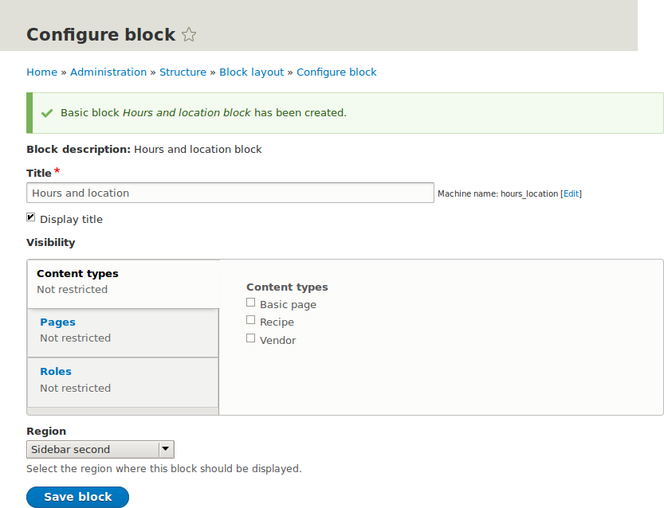
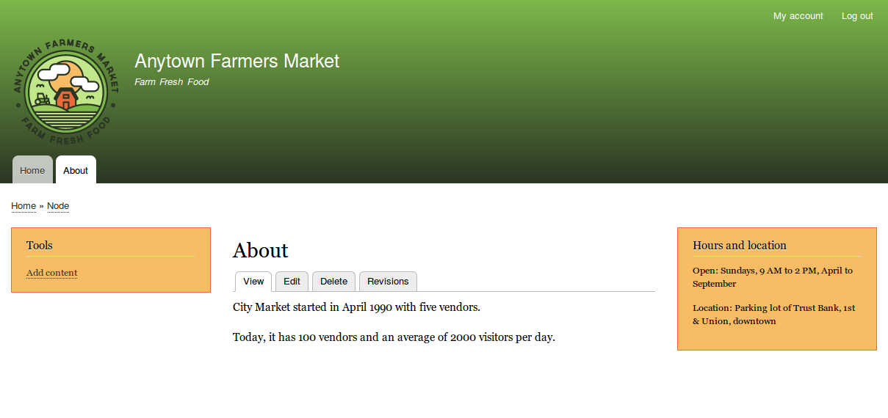

[[block-place]]

=== Colocar un bloque en una región

[role="summary"]
Cómo colocar un bloque en una región.

(((Block,placing in a region)))
(((Region,placing a block in)))

==== Objetivo

Colocar el bloque Hours and location en la barra lateral del sitio web.

==== Conocimientos previos

<<block-concept>>

==== Requisitos previos del sitio web

* El tema del núcleo Olivero debe estar instalado y establecido como
predeterminado. Ver <<config-theme>>.

* El bloque Hours and location debe existir. Ver <<block-create-custom>>.

==== Pasos

. En el menú administrativo _Manage_, vaya a _Structure_ > _Block layout_
(_admin/structure/block_). Aparece la página _Block layout_, que lista las
regiones del tema.

. Asegúrese de que en la pestaña secundaria esté seleccionado el tema del
núcleo Olivero. La colocación de bloques se define por tema.

. Localice la región _Sidebar_ en la lista y haga clic en _Place block_ junto a
ella. Aparece la ventana _Place block_, que lista todos los bloques.

. Localice el bloque Hours and location y haga clic en _Place block_ junto a
él. Aparece la ventana _Configure block_. Rellene los campos como se muestra a
continuación.
+
[width="100%",frame="topbot",options="header"]
|================================
|Nombre del campo |Explicación |Valor de ejemplo
|Title |Título que se mostrará para el bloque |Hours and location
|Display title |Si se muestra o no el título con el bloque |Marcado
|Region |En qué región del tema mostrarlo |Sidebar
|================================
+
También puede ocultar o mostrar el bloque en páginas específicas. En el caso
del sitio web del mercado de agricultores no establece ninguna de estas
opciones de configuración porque quiere mostrar el bloque en todas partes.
+
--
// Configuration page for placing a custom block in the sidebar.

--

. Haga clic en _Save block_. Aparece la página _Block layout_. Puede arrastrar
los tiradores en cruz de los bloques para cambiar su orden dentro de cada
región. Como alternativa a arrastrar, puede hacer clic en el enlace _Show row
weights_ situado en la parte superior de la tabla y seleccionar pesos numéricos
(los bloques con pesos menores o más negativos se mostrarán primero).

. Compruebe que el bloque Hours and location aparece en la región _Sidebar_ y
haga clic en _Save blocks_.
+
El bloque se ha colocado en la barra lateral de todas las páginas que utilizan
el tema del núcleo Bartik.
+
--
// About page with placed sidebar block.

--

==== Ampliar conocimiento

* Quite el bloque _Powered by Drupal_ de la región _Footer Bottom_ haciendo
clic en _Disable_ o _Remove_ en el botón desplegable _Operations_. Al hacer
clic en _Disable_ podrá volver a activar el bloque fácilmente más adelante con
la misma configuración; si hace clic en _Remove_ y quiere recuperar el bloque,
tendría que seguir de nuevo los pasos de este tema para colocarlo en una
región. Tenga en cuenta que los nombres de los bloques que proporciona el
software del núcleo, como _Powered by Drupal_ y _User login_, se muestran en
inglés en esta página; ver <<language-concept>> para una explicación.

* Coloque el bloque _User login_ en una región.

* Si no ve el efecto de estos cambios en su sitio, puede que tenga que borrar
la caché. Ver <<prevent-cache-clear>>.

//==== Conceptos relacionados

==== Vídeos

// Video from Drupalize.Me.
video::https://www.youtube-nocookie.com/embed/iWW7Ja5p0hA[title="Placing a Block in a Region"]

//==== Recursos adicionales

*Atribuciones*

Escrito y editado por https://www.drupal.org/u/batigolix[Boris Doesborg],
https://www.drupal.org/u/jhodgdon[Jennifer Hodgdon] y
https://www.drupal.org/u/eojthebrave[Joe Shindelar] en
https://drupalize.me[Drupalize.Me].

Traducido por https://www.drupal.org/u/juancasantito[Juan Santovenia].
