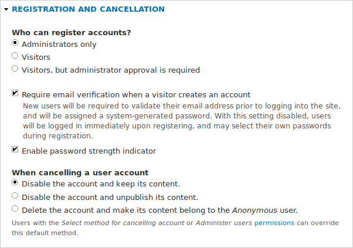
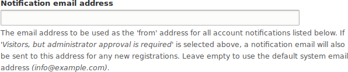
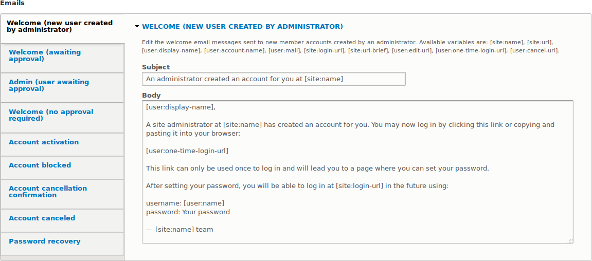

[[config-user]]

=== Configuración de los ajustes de la cuenta de usuario

[role="summary"]
Cómo cambiar los ajustes de registro de cuentas de usuario.

(((User,configuring account setting)))
(((Account setting,configuring)))
(((Security,managing user accounts)))
(((Security,user account settings)))

==== Objetivo

Desactivar la posibilidad de que la gente registre cuentas de usuario en el
sitio. Además, revisar o editar los mensajes de correo electrónico que genera
el sitio para eventos relacionados con las cuentas de usuario.

==== Conocimientos previos

<<config-overview>>

//==== Site prerequisites

==== Pasos

. En el menú administrativo _Manage_, vaya a _Configuration_ > _People_ >
_Account settings_ (_admin/config/people/accounts_).

. En _Registration and cancellation_, seleccione _Administrators only_ como las
personas con permiso para registrar cuentas de usuario. Puede marcar _Require
email verification when a visitor creates an account_ por si quiere cambiar los
ajustes de registro de cuentas más adelante.
+
--
// Registration and cancellation section of admin/config/people/accounts.

--

. Opcionalmente, cambie la dirección de correo electrónico predeterminada desde
la que se enviarán las notificaciones de cuenta de usuario del sitio web del
mercado de agricultores. Esto le ayudará a mantener una dirección de correo
electrónico separada de la que se usa para el sitio web en general. Por
ejemplo, esta dirección de correo para las notificaciones de cuenta de usuario
será útil para el personal que se comunica con los vendors.
+
--
// Email address section of admin/config/people/accounts.

--

. Opcionalmente, edite las plantillas de correo en _Emails_ para personalizar
los correos automatizados. El software del núcleo proporciona varias plantillas
de correo, pensadas para distintas situaciones relacionadas con el usuario.
Todas se pueden personalizar y tres se pueden desactivar mediante casillas de
verificación: activación, bloqueo y cancelación.
+
Puede enviar su propio texto (por ejemplo, dando la bienvenida a los nuevos
vendors para los que se acaban de crear cuentas) editando la plantilla
_Welcome (new user created by administrator)_.
+
--
// Emails section of admin/config/people/accounts.

--

. Haga clic en _Save configuration_ para guardar los cambios.

==== Ampliar conocimiento

* <<prevent-cache-clear>>
* <<user-new-user>>

==== Conceptos relacionados

Ver <<user-chapter>> para más información sobre las cuentas de usuario y los
permisos.

==== Vídeos

// Video from Drupalize.Me.
video::https://www.youtube-nocookie.com/embed/POhQTAX93R8[title="Configuring User Account Settings"]

==== Recursos adicionales

https://www.drupal.org/security/secure-configuration[Securing your site] puede
ayudarle con un enfoque más centrado en la seguridad a la hora de configurar.

*Atribuciones*

Escrito y editado por https://www.drupal.org/u/lolk[Laura Vass] en
https://pronovix.com/[Pronovix], y
https://www.drupal.org/u/jojyja[Jojy Alphonso] en
http://redcrackle.com[Red Crackle].

Traducido por https://www.drupal.org/u/juancasantito[Juan Santovenia].
