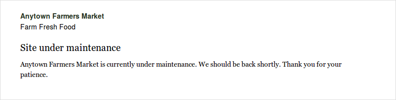
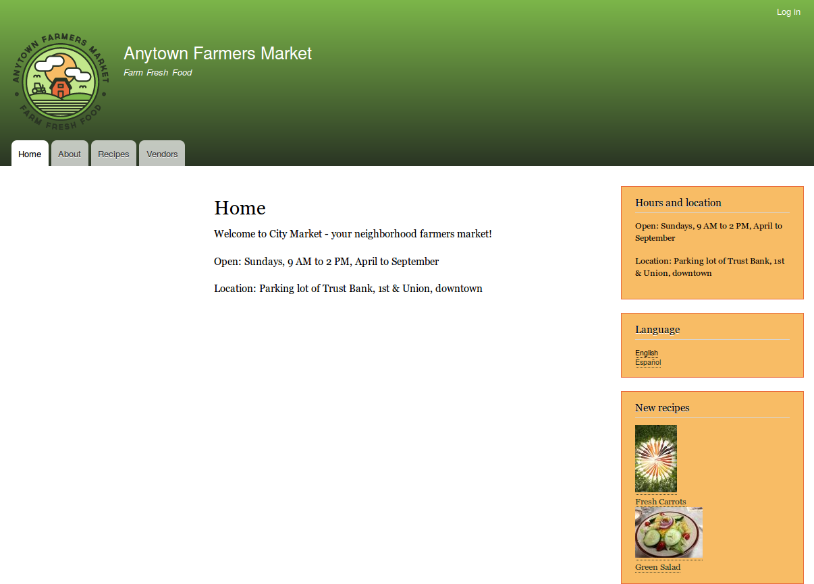

[[extend-maintenance]]

=== Habilitar y deshabilitar el modo de mantenimiento

[role="summary"]
Cómo habilitar el modo de mantenimiento para configurar un mensaje de "Sitio en
mantenimiento" y cómo deshabilitarlo.

(((Maintenance mode,overview)))
(((Maintenance mode,enabling)))
(((Maintenance mode,disabling)))

==== Objetivo

Poner su sitio en modo de mantenimiento para permitir que los usuarios con los
permisos adecuados usen el sitio, mientras que a los usuarios sin ese permiso
se les muestra un mensaje de que el sitio está en mantenimiento.

==== Conocimientos previos

<<security-concept>>

==== Requisitos previos del sitio web

Si quiere usar Drush para habilitar o deshabilitar el modo de mantenimiento,
Drush debe estar instalado. Ver <<install-tools>>.

==== Pasos

Puede usar la interfaz administrativa o Drush para habilitar o deshabilitar el
modo de mantenimiento.

===== Habilitar el modo de mantenimiento con la interfaz administrativa

. En el menú administrativo _Manage_, vaya a _Configuration_ > _Development_ >
_Maintenance mode_ (_admin/config/development/maintenance_). Aparece la página
_Maintenance mode_.

. Rellene los campos como se muestra a continuación.
+
[width="100%",frame="topbot",options="header"]
|================================
|Nombre del campo | Explicación | Valor

| Put site into maintenance mode | Habilitar el modo de mantenimiento |
Marcado

| Message to display when in maintenance mode | La información que se muestra a
los visitantes del sitio web cuando el modo está habilitado. En el mensaje se
pueden usar variables como @site |@site is currently under maintenance but
should be back shortly. Thank you for your patience.

|================================

. Haga clic en _Save configuration_.

. Compruebe que el sitio está en modo de mantenimiento accediendo a él desde
otro navegador en el que no haya iniciado sesión. Si no puede comprobarlo,
intente borrar la caché. Ver <<prevent-cache-clear>>.
+
--
// Site in maintenance mode.

--

===== Deshabilitar el modo de mantenimiento con la interfaz administrativa

. En el menú administrativo _Manage_, vaya a _Configuration_ > _Development_ >
_Maintenance mode_ (_admin/config/development/maintenance_). Aparece la página
_Maintenance mode_.

. Rellene los campos como se muestra a continuación.
+
[width="100%",frame="topbot",options="header"]
|================================
|Nombre del campo | Explicación | Valor

| Put site into maintenance mode | Deshabilitar el modo de mantenimiento |
Sin marcar

| Message to display when in maintenance mode | No se necesita ningún mensaje al deshabilitarlo. Puede dejar el campo en blanco. |

|================================

. Haga clic en _Save configuration_.

. Compruebe que el sitio ya no está en modo de mantenimiento accediendo a él
desde otro navegador en el que no haya iniciado sesión. Si no puede
comprobarlo, intente borrar la caché. Ver <<prevent-cache-clear>>.
+
--
// Site no longer in maintenance mode.

--

===== Habilitar o deshabilitar el modo de mantenimiento con Drush

. Siga los pasos de la interfaz de usuario anteriores para editar el mensaje de
mantenimiento del sitio, si lo desea.

. Ejecute los siguientes comandos de Drush para habilitar el modo de
mantenimiento y borrar la caché:
+
----
drush config:set system.maintenance message "Optional message" -y
drush state:set system.maintenance_mode 1 --input-format=integer
drush cache:rebuild
----

. Ejecute los siguientes comandos de Drush para deshabilitar el modo de
mantenimiento y borrar la caché:
+
----
drush state:set system.maintenance_mode 0 --input-format=integer
drush cache:rebuild
----

. Después de ejecutar cualquiera de los dos conjuntos de comandos, compruebe si
su sitio está dentro o fuera del modo de mantenimiento visitándolo en un
navegador en el que no haya iniciado sesión.

==== Ampliar conocimiento

* <<security-update-core>>

* <<security-update-theme>>

* <<security-update-module>>

//==== Related concepts

==== Vídeos

// Video from Drupalize.Me.
video::https://www.youtube-nocookie.com/embed/IQbqQs5h03Q[title="Enabling and Disabling Maintenance Mode"]

// ==== Additional resources

*Atribuciones*

Escrito y editado por https://www.drupal.org/u/batigolix[Boris Doesborg],
https://www.drupal.org/u/jojyja[Jojy Alphonso] en
http://redcrackle.com[Red Crackle] y
https://www.drupal.org/u/jhodgdon[Jennifer Hodgdon].

Traducido por https://www.drupal.org/u/juancasantito[Juan Santovenia].
