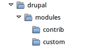

[[extend-manual-install]]

=== Instalar manualmente archivos de módulos o temas

[role="summary"]
Cómo instalar manualmente un módulo o un tema.

(((Module,downloading)))
(((Contributed module,downloading)))
(((Theme,downloading)))
(((Contributed theme,downloading)))
(((Downloading,module or theme files manually)))
(((Manually downloading module or theme files,overview)))

==== Objetivo

Puede que los módulos y temas personalizados no estén disponibles a través de
Composer y haya que instalar sus archivos manualmente.

==== Conocimientos previos

* <<understanding-modules>>
* <<extend-module-find>>
* <<understanding-themes>>
* <<extend-theme-find>>

==== Requisitos previos del sitio web

Use este método si creó un módulo o tema personalizado o recibió sus archivos de
otra persona.

Al instalar o actualizar el software del núcleo, los módulos contribuidos y los
temas contribuidos debería usar Composer. Consulte <<install-composer>>,
<<extend-module-install>> y <<extend-theme-install>> en lugar de este tema.

==== Pasos

Si está instalando un módulo o tema desde _Drupal.org_, siga las instrucciones
de descarga y luego las de subida/descompresión. Si creó usted el módulo o el
tema, sáltese el paso de descarga; en su lugar, cree un archivo comprimido (que
sepa extraer en el servidor) y continúe con los pasos de subida/descompresión,
usando el método que corresponda a la forma en que creó inicialmente el archivo
comprimido.

===== Subir los archivos a su sitio y descomprimirlos

. Si está añadiendo un nuevo módulo o tema, cree subdirectorios en sus
directorios de nivel superior _modules_ y _themes_ (si aún no existen).
Habitualmente se crea un subdirectorio _contrib_ para los módulos y temas
contribuidos que se descargan de _Drupal.org_, y un subdirectorio _custom_ para
los módulos y temas que uno crea. Su directorio _modules_ podría tener este
aspecto:
+
--
// Make custom and contrib directories under modules, and take a screenshot
// showing the directory structure.

// NOTE for Translators: you don't need to localize the 'custom' and 'contrib' directory names as they are more common in English.
--

. Si está reemplazando un módulo o tema existente por una versión actualizada,
ponga el sitio en modo de mantenimiento. Ver <<extend-maintenance>>.

. Si está reemplazando un módulo o tema existente por una versión actualizada,
busque y elimine todos los archivos y directorios existentes de ese módulo o
tema. Los módulos suelen estar en directorios bajo el directorio de nivel
superior _modules_, y los temas suelen estar en directorios bajo el directorio
de nivel superior _themes_.

. Suba el archivo _.tar.gz_ (o el archivo comprimido que haya creado) a su
sitio. Colóquelo en la misma ubicación de la que eliminó el directorio (si está
reemplazando un módulo o tema existente) o en el subdirectorio adecuado de
_modules_ o _themes_ (si está añadiendo un nuevo módulo o tema).

. Extraiga los archivos del archivo _.tar.gz_ (o del que haya creado),
creando un subdirectorio en la misma ubicación que el archivo comprimido. Si no
tiene acceso por terminal, o su servidor de alojamiento no funciona con Linux,
el administrador de archivos del panel de control de su alojamiento debería
ofrecer una forma de extraer los archivos. Si tiene acceso por terminal a su
servidor de alojamiento (con Linux) y está usando un archivo tar.gz, puede usar
un comando como:
+
----
tar -xzf custom_toolbar-2.4.0.tar.gz
----

. Elimine el archivo comprimido del servidor, a menos que su método de
descompresión ya lo haya eliminado.

. Consulte <<extend-module-install>>, <<extend-theme-install>>,
<<security-update-module>> o <<security-update-theme>> para completar la
instalación o actualización del módulo o del tema. Empiece en el paso posterior
a que se haya completado la descarga automática.

==== Ampliar conocimiento

* Si trabaja con varios entornos (por ejemplo, un sitio de desarrollo local y un
sitio en producción), tendrá que repetir los pasos en cada entorno o volver a
clonar el entorno. Ver <<install-dev-making>>.

* Si añadió un nuevo tema, en el menú administrativo _Manage_ vaya a
_Appearance_ (_admin/appearance_) y desinstale el tema antiguo.

// ==== Related concepts

==== Vídeos

// Video from Drupalize.Me.
video::https://www.youtube-nocookie.com/embed/kOzQz9q3Kf8[title="Manually Downloading Module or Theme Files"]

==== Recursos adicionales

* https://www.drupal.org/docs/extending-drupal/updating-modules[_Drupal.org_ community documentation page "Updating modules"]
* https://www.drupal.org/docs/extending-drupal/installing-drupal-modules[_Drupal.org_ community documentation page "Installing Drupal modules"]
* https://www.drupal.org/docs/extending-drupal/installing-themes[_Drupal.org_ community documentation page "Installing themes"]

*Atribuciones*

Escrito y editado por https://www.drupal.org/u/batigolix[Boris Doesborg],
https://www.drupal.org/u/jhodgdon[Jennifer Hodgdon] y
https://www.drupal.org/u/vegantriathlete[Marc Isaacson], y
https://www.drupal.org/u/eojthebrave[Joe Shindelar] en https://drupalize.me[Drupalize.Me].

Traducido por https://www.drupal.org/u/alvar0hurtad0[Alvaro Hurtado].
