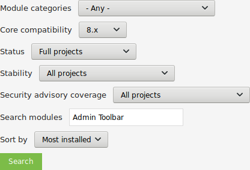
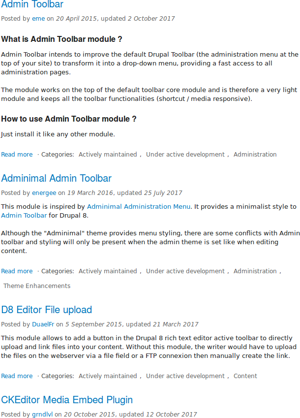
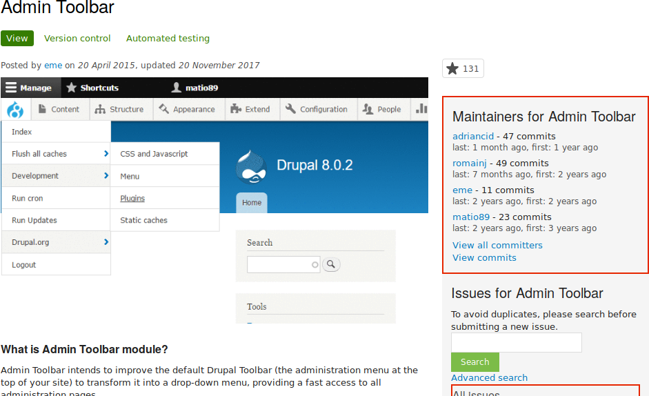

[[extend-module-find]]

=== Encontrar módulos

[role="summary"]
Cómo buscar y evaluar módulos en Drupal.org.

(((Module,finding)))
(((Module,evaluating)))
(((Contributed module,finding)))
(((Contributed module,evaluating)))
(((Drupal.org website,finding and evaluating modules on)))

==== Objetivo

Encontrar y evaluar módulos en _Drupal.org_.

==== Conocimientos previos

* <<understanding-drupal>>
* <<understanding-modules>>

//==== Site prerequisites

==== Pasos

. Vaya a https://www.drupal.org[_Drupal.org_] y navegue a _Download &
Extend_ > _Modules_ (https://www.drupal.org/project/project_module).

. Filtre su búsqueda usando las categorías de la página de búsqueda de módulos.
Rellene los campos como se muestra a continuación.
+
[width="100%",frame="topbot",options="header"]
|================================
|Nombre del campo |Explicación |Valor de ejemplo
|Maintenance status |¿Con qué nivel de actividad debería mantenerse el módulo? | Actively maintained
|Development status |¿Qué tipo de desarrollo debería tener el módulo?| Any
|Module categories |El área temática del módulo.|Administration
|Core compatibility |La versión del software del núcleo con la que es compatible el módulo.|9.x
|Status |Estado del proyecto: los _Sandbox projects_ son proyectos experimentales. Los _Full projects_ ya
 han pasado por un proceso de aprobación, pero aún pueden estar en desarrollo. |Full projects
|Stability | Si la persona que mantiene el proyecto ha creado una versión lista para producción.
 |Has a supported stable release
|Security advisory coverage | Si la persona que mantiene el proyecto ha aceptado seguir los procedimientos
 del Equipo de Seguridad de Drupal. |Has security advisory coverage
|Search modules |Busque _Admin Toolbar_, un módulo que se tratará en detalle más adelante.
 Como alternativa, puede dejar el campo en blanco si no está seguro de qué módulo buscar.
 |Admin Toolbar
|Sort by |Ordene los resultados de la búsqueda por criterios como _Most installed_ (módulos populares que usan muchos
 sitios) o _Last release_ (fecha de la última versión publicada). |Most installed
|================================
+
--
// Module search box on https://www.drupal.org/project/project_module.

--

. Haga clic en _Search_. Aparecerán los resultados de la búsqueda.
+
--
// Search results on https://www.drupal.org/project/project_module.

--

. Para evaluar un módulo con más detalle, haga clic en su título en la lista de
resultados de la búsqueda para visitar la página de su proyecto.

Algunos aspectos a los que prestar atención al evaluar módulos:

* Project description: la descripción del módulo en la página de su proyecto
debería ser clara y útil. Debería hacerse una idea de sus funcionalidades y
requisitos.

* Project information: puede haber avisos en esta zona de la página, por
ejemplo si un módulo ya no se desarrolla o no está cubierto por la política de
avisos de seguridad.

* Project information > Reported installs, downloads: puede ver cuántas personas
lo han descargado y cuántos sitios usan el módulo. Si solo lo usan unos pocos
sitios, podría ser una solución específica que no mucha gente necesita, o podría
ser una señal de alerta de que usted tampoco debería usarlo.

* Maintainers: ¿cuándo fue el último commit (la última vez que alguien
actualizó algo del módulo) o la última versión? Si el proyecto tiene pocas
incidencias abiertas, que haya pasado mucho tiempo desde los commits o
versiones puede ser aceptable, pero si tiene muchas incidencias abiertas y no
hay commits ni versiones, sería una pista de que podría estar abandonado.

* Issues: compruebe si hay incidencias abiertas, posibles problemas con el
módulo. Consulte las Statistics para ver con qué frecuencia se responde a las
incidencias.

* Documentation, Resources: compruebe si el módulo tiene documentación o un
archivo README que pueda ayudarle a instalarlo, configurarlo, explorarlo y
probarlo.
+
--
// Project page for Admin Toolbar module.

--

==== Ampliar conocimiento

<<extend-module-install>>

//==== Related concepts

==== Vídeos

// Video from Drupalize.Me.
video::https://www.youtube-nocookie.com/embed/G-XUuSj9xYA[title="Finding Modules"]

//==== Additional resources

*Atribuciones*

Escrito por https://www.drupal.org/u/dianalakatos[Diána Lakatos] en
https://pronovix.com//[Pronovix].

Traducido por https://www.drupal.org/u/isaura[Isaura Galafate].
