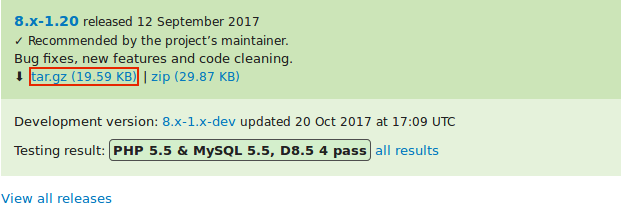
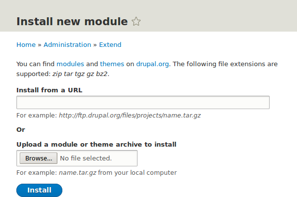

[[extend-module-install]]

=== Descargar e instalar un módulo desde _Drupal.org_

[role="summary"]
Cómo descargar e instalar un módulo desde Drupal.org.

(((Module,downloading)))
(((Module,installing)))
(((Module,enabling)))
(((Module,contributed)))
(((Module,custom)))
(((Downloading,module)))
(((Installing,module)))
(((Enabling,module)))
(((Contributed module,downloading)))
(((Contributed module,installing)))
(((Functionality,extending)))
(((Drush tool,using to install module)))
(((Admin Toolbar module,downloading)))
(((Admin Toolbar module,installing)))
(((Module,Admin Toolbar)))
(((Drupal.org website,downloading and installing module from)))

==== Objetivo

Descargar e instalar el
https://www.drupal.org/project/admin_toolbar[módulo contribuido Admin Toolbar],
que le permite navegar fácilmente por la sección de administración del sitio
web.

==== Conocimientos previos

* <<understanding-modules>>
* <<extend-module-find>>
* <<install-tools>>

==== Requisitos previos del sitio web

Composer debe estar instalado para descargar módulos. Si quiere usar Drush,
Drush debe estar instalado. Ver <<install-tools>>.

==== Pasos

Para instalar un módulo contribuido, primero descargue el módulo con Composer.
Después instálelo usando la interfaz administrativa o Drush. Si está instalando
un módulo personalizado en lugar de un módulo contribuido que no está
disponible a través de Composer, omita los pasos de descarga del módulo y
consulte <<extend-manual-install>>. Después vuelva aquí y siga los pasos para
instalar el módulo con la interfaz administrativa o con Drush.

===== Descargar el módulo contribuido con Composer

. En la página del proyecto de _Admin toolbar_ en drupal.org
(_https://www.drupal.org/project/admin_toolbar_), desplácese hasta la sección
_Releases_ al final de la página.

. Copie el comando de Composer que se proporciona para la versión del módulo
que quiere instalar.
+
--
// Releases section of the Admin Toolbar project page on Drupal.org.

--

. Como alternativa, escriba el siguiente comando (sustituyendo
+admin_toolbar:^3.5+ por el nombre corto del módulo y la versión deseada):
+
----
composer require 'drupal/admin_toolbar:^3.5'
----

. En la línea de comandos, sitúese en el directorio raíz de su proyecto. Pegue
el comando de Composer y ejecútelo.

. Debería ver un mensaje indicando que el módulo se ha descargado
correctamente.

===== Instalar el módulo con la interfaz administrativa

. En el menú administrativo _Manage_, vaya a _Extend_ (_admin/modules_). Aparece
la página _Extend_.

. Busque el módulo _Admin toolbar_ y márquelo.
+
--
// Extend page showing Admin Toolbar module checked.

--

. Haga clic en _Install_ para activar el nuevo módulo.

===== Instalar el módulo con Drush

. Ejecute el siguiente comando de Drush, pasando el nombre del proyecto (por
ejemplo, `admin_toolbar`) como parámetro:
+
----
drush pm:enable admin_toolbar
----

. Siga las instrucciones que aparezcan en pantalla.

==== Ampliar conocimiento

* Compruebe que el
https://www.drupal.org/project/admin_toolbar[módulo contribuido Admin Toolbar]
funciona navegando por el menú de la sección de administración.

* Instale y configure el
https://www.drupal.org/project/pathauto[módulo contribuido Pathauto] para que
las páginas de contenido de su sitio tengan URLs limpias de forma
predeterminada. Ver <<content-paths>> para más información sobre las URLs.

* Si no ve el efecto de estos cambios en su sitio, puede que tenga que borrar
la caché. Ver <<prevent-cache-clear>>.

//==== Related concepts

==== Vídeos

// Video from Drupalize.Me.
video::https://www.youtube-nocookie.com/embed/vx9nWJE1Kbk[title="Downloading and Installing a Module from Drupal.org"]

==== Recursos adicionales

* https://www.drupal.org/docs/extending-drupal/installing-drupal-modules[_Drupal.org_ community documentation page "Installing Drupal modules"]
* https://www.drupal.org/download["Download and Extend" page on _Drupal.org_]
* https://www.drupal.org/project/admin_toolbar[Admin Toolbar module on _Drupal.org_]

*Atribuciones*

Escrito y editado por https://www.drupal.org/u/batigolix[Boris Doesborg],
https://www.drupal.org/u/eojthebrave[Joe Shindelar] en
https://drupalize.me[Drupalize.Me], y
https://www.drupal.org/u/jhodgdon[Jennifer Hodgdon].

Traducido por https://www.drupal.org/u/skuark[Jesús Manuel García].
