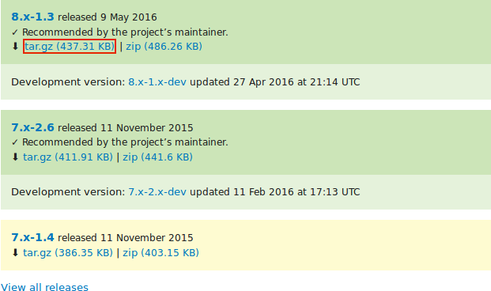
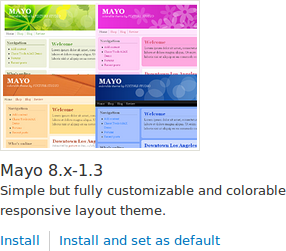

[[extend-theme-install]]

=== Descargar e instalar un tema desde _Drupal.org_

[role="summary"]
Cómo descargar e instalar un tema desde Drupal.org.

(((Theme,downloading)))
(((Theme,installing)))
(((Theme,enabling)))
(((Theme,contributed)))
(((Theme,custom)))
(((Contributed theme,downloading)))
(((Contributed theme,installing)))
(((Contributed theme,enabling)))
(((Custom theme,installing)))
(((Custom theme,enabling)))
(((Downloading,theme)))
(((Installing,theme)))
(((Enabling,theme)))
(((Drush tool,using to install theme)))
(((Drupal.org website,downloading and installing theme from)))

==== Objetivo

Descargar e instalar un tema desde _Drupal.org_.

==== Conocimientos previos

* <<extend-theme-find>>
* <<install-tools>>

==== Requisitos previos del sitio web

Composer debe estar instalado para descargar temas. Si quiere usar Drush, Drush
debe estar instalado. Ver <<install-tools>>.

==== Pasos

Para instalar un tema contribuido, primero descargue el tema con Composer.
Después instálelo usando la interfaz administrativa o Drush. Si está instalando
un tema personalizado en lugar de un tema contribuido que no está disponible a
través de Composer, omita los pasos de descarga del tema y consulte
<<extend-manual-install>>. Después vuelva aquí y siga los pasos para instalar el
tema con la interfaz administrativa o con Drush.

===== Descargar el tema contribuido con Composer

. En la página del proyecto del tema en drupal.org (por ejemplo,
_https://www.drupal.org/project/honey_), desplácese hasta la sección _Releases_
al final de la página.

. Copie el comando de Composer que se proporciona para la versión del tema que
quiere instalar.
+
--
// Releases section of a theme project page on drupal.org.

--

. Como alternativa, escriba el siguiente comando (sustituyendo +honey:^1.0+ por
el nombre corto del tema y la versión deseada):
+
----
composer require 'drupal/honey:^1.0'
----

. En la línea de comandos, sitúese en el directorio raíz de su proyecto. Pegue
el comando de Composer y ejecútelo.

. Debería ver un mensaje indicando que el tema se ha descargado correctamente.

===== Instalar el tema con la interfaz administrativa

. En el menú administrativo _Manage_, vaya a _Appearance_ (_admin/appearance_).
Aparece la página _Appearance_.

. Busque el nuevo tema en _Uninstalled themes_ y haga clic en _Install and set
as default_ para usarlo. A partir de ahora, todas las páginas no
administrativas del sitio usarán este nuevo tema.
+
--
// Honey theme on the Appearance page.

--

===== Instalar el tema con Drush

. Para instalar el tema y establecerlo como predeterminado, ejecute los
siguientes comandos de Drush, pasando el nombre del proyecto (por ejemplo,
_honey_) como parámetro:
+
----
drush theme:enable honey
drush config:set system.theme default honey
----

. Siga las instrucciones que aparezcan en pantalla.

==== Ampliar conocimiento

* En el menú administrativo _Manage_, vaya a _Appearance_ (_admin/appearance_) y
desinstale los temas que no esté usando.

* <<extend-module-find>>

* <<extend-module-install>>

* Si no ve el efecto de estos cambios en su sitio, puede que tenga que borrar
la caché. Ver <<prevent-cache-clear>>.

// ==== Related concepts

==== Vídeos

// Video from Drupalize.Me.
video::https://www.youtube-nocookie.com/embed/UFgddj0F_bU[title="Downloading and Installing a Theme from Drupal.org"]

//==== Additional resources

*Atribuciones*

Escrito y editado por https://www.drupal.org/u/eojthebrave[Joe Shindelar] en
https://drupalize.me[Drupalize.Me], y
https://www.drupal.org/u/batigolix[Boris Doesborgh].

Traducido por https://www.drupal.org/u/skuark[Jesús Manuel García].
