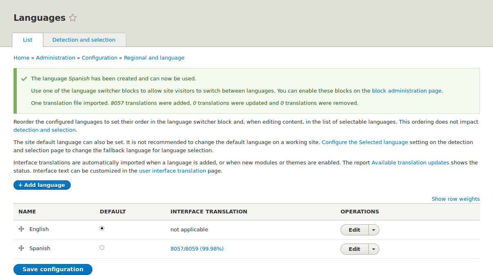

[[language-add]]

=== Añadir un idioma

[role="summary"]
Cómo añadir un idioma, instalar los módulos necesarios y activar el bloque
_Language switcher_.

(((Language,adding)))
(((Multilingual modules,installing)))
(((Multilingual modules,enabling)))
(((Language module,installing)))
(((Content Translation module,installing)))
(((Configuration Translation module,installing)))
(((Interface Translation module,installing)))
(((Module,Language)))
(((Module,Content Translation)))
(((Module,Configuration Translation)))
(((Module,Interface Translation)))

==== Objetivo

Añadir uno o varios idiomas a su sitio y definir cuál se usa de forma
predeterminada.

==== Conocimientos previos

<<language-concept>>

// ==== Site prerequisites

==== Pasos

. Instale los cuatro módulos multilingües del núcleo (Language, Interface
Translation, Content Translation y Configuration Translation) siguiendo los
pasos de <<config-install>>.

. En el menú administrativo _Manage_, vaya a _Configuration_ > _Region and
language_ > _Languages_ (_admin/config/regional/language_).

. Haga clic en _Add language_.

. Seleccione _Spanish_ (o el idioma que prefiera) en la lista de selección
_Language name_. Haga clic en _Add language_. Después de esperar a que
terminen de descargarse las traducciones, volverá a la página _Languages_, con
un mensaje de confirmación y el nuevo idioma en la lista.
+
--
// Confirmation and language list after adding Spanish language.

--

. Siga los pasos de <<block-place>> para colocar el bloque _Language switcher_
en la región _Sidebar second_. Esto permitirá a los visitantes del sitio
cambiar de idioma, una vez que el sitio se haya traducido.

==== Ampliar conocimiento

* <<language-content-config>>
* <<language-content-translate>>

// ==== Related concepts

==== Vídeos

// Video from Drupalize.Me.
video::https://www.youtube-nocookie.com/embed/8Yu0G4gJ0f4[title="Adding a Language"]

==== Recursos adicionales

https://www.drupal.org/docs/multilingual-guide[_Drupal.org_ community documentation page "Multilingual guide"]

*Atribuciones*

Escrito y editado por https://www.drupal.org/u/yrvyn[Leila Tite],
https://www.drupal.org/u/jhodgdon[Jennifer Hodgdon] y
https://www.drupal.org/u/batigolix[Boris Doesborg].

Traducido por https://www.drupal.org/u/juancasantito[Juan Santovenia].
