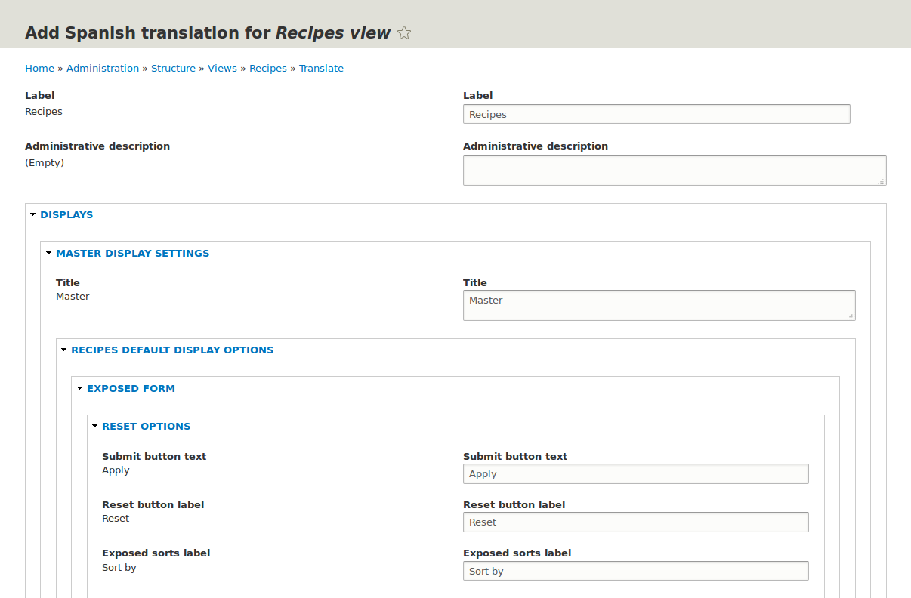

[[language-config-translate]]
=== Traducir la configuración

[role="summary"]
Cómo traducir las etiquetas de los campos de una vista y otra configuración.

(((Configuration,translating)))
(((View,translating)))
(((Label,translating)))
(((Translating,configuration)))
(((Translating,view)))
(((Translating,label)))

==== Objetivo

Traducir al español las etiquetas de la página de la vista Recipes.

==== Conocimientos previos

* <<language-concept>>
* <<views-create>>

==== Requisitos previos del sitio web

* El módulo del núcleo Configuration Translation debe estar instalado y su sitio
debe tener al menos dos idiomas. Ver <<language-add>>.

* La vista Recipes debe existir. Ver <<views-create>> y <<views-duplicate>>.

==== Pasos

Los pasos básicos para traducir cualquier configuración de su sitio son:

. En el menú administrativo _Manage_, vaya a _Configuration_ > _Regional and
Language_ > _Configuration translation_
(_admin/config/regional/config-translation_).

. Localice el elemento de configuración que quiere traducir. Por ejemplo, para
traducir el nombre del sitio, tiene que buscar _System information_. Para la
configuración que se agrupa por tipo (por ejemplo, vistas o formatos de fecha),
haga clic en el botón _List_ para listar toda la configuración de ese tipo y
después localice el elemento que busca.

. Haga clic en _Translate_ en el elemento que localizó.

. Busque un botón que le permita añadir una traducción en el idioma deseado y
haga clic en él.

. Introduzca la traducción en el formulario y guárdela.

La mayoría de la configuración es bastante sencilla e intuitiva de editar de
esta forma. La configuración de las vistas es una excepción, porque el
formulario de edición de la traducción no se parece en nada al formulario de
edición de la vista, y es complejo y jerárquico en lugar de ser un formulario
simple con unos pocos campos. Como ejemplo de cómo traducir una vista, estos son
los pasos para traducir al español las etiquetas de la vista Recipes:

. En el menú administrativo _Manage_, vaya a _Configuration_ > _Regional and
Language_ > _Configuration translation_
(_admin/config/regional/config-translation_).

. Haga clic en _List_ en la fila _Views_.

. Haga clic en _Translate_ en la fila de Recipes.

. Haga clic en _Add_ en la fila _Spanish_. Aparece la página _Add Spanish
translation for Recipes view_.

. En _Displays_ > _Default Display settings_ > _Recipes default display
Options_, traduzca _Display title_ de "Recipes" a "Recetas".

. En _Displays_ > _Default display settings_ > _Recipes default display
options_ > _Exposed form_ > _Reset options_, traduzca _Submit button text_ de
"Apply" a "Aplicar". Los demás botones y etiquetas de esta sección no aparecen
en la página ni en el bloque de Recipes, y no hace falta traducirlos.
+
--
// Exposed form options for Recipes view.

--

. En _Displays_ > _Default display settings_ > _Recipes default display
options_ > _Filters_ > _(Empty) taxonomy term ID_ > _Find recipes
using... Expose_, traduzca _Label_ de "Find recipes using..." a "Encontrar
recetas usando...".

. Haga clic en _Save translation_.

. Vaya a la página de Recipes y cambie al español con el bloque Language
switcher. Compruebe que las etiquetas se han traducido.

==== Ampliar conocimiento

* Traduzca el título del bloque en la sección de ajustes de visualización Recent
recipes de la vista Recipes.

* Traduzca el título de la página en la vista Vendors.

* Traduzca otra configuración. Algunos ejemplos de dónde encontrar las páginas
de traducción:

** Para traducir el nombre del sitio, en el menú administrativo _Manage_ vaya a
_Configuration_ > _System_ > _Basic site settings_ > _Translate system
information_ (_admin/config/system/site-information/translate_).

** Para traducir el formulario de contacto, en el menú administrativo _Manage_
vaya a _Structure_ > _Contact forms_ (_admin/structure/contact_). Haga clic en
_Translate_ en el botón desplegable de la fila _Website feedback_.

** Para traducir el nombre de un menú, en el menú administrativo _Manage_ vaya a
_Structure_ > _Menus_ (_admin/structure/menu_). Haga clic en _Translate_ en el
botón desplegable del menú cuyo nombre quiere traducir.

** Los enlaces de menú dentro de un menú se consideran contenido (no
configuración); ver <<language-content-config>> para habilitar su traducción.
Una vez habilitada la traducción, en el menú administrativo _Manage_ vaya a
_Structure_ > _Menus_ (_admin/structure/menu_). Haga clic en _Edit menu_ en el
botón desplegable del menú cuyos enlaces quiere traducir. Haga clic en
_Translate_ en el botón desplegable del enlace que quiere traducir.

** Para traducir las etiquetas de los campos de un tipo de contenido, en el
menú administrativo _Manage_ vaya a _Structure_ > _Content types_
(_admin/structure/types_). Haga clic en _Manage fields_ en el botón desplegable
del tipo de contenido cuyas etiquetas de campo quiere editar. Haga clic en
_Translate_ en el botón desplegable del campo cuya etiqueta quiere editar.

* Traduzca contenido. Ver <<language-content-translate>>.

// ==== Related concepts

==== Vídeos

// Video from Drupalize.Me.
video::https://www.youtube-nocookie.com/embed/j2GZdJIOo_I[title="Translating Configuration"]

// ==== Additional resources

*Atribuciones*

Escrito y editado por https://www.drupal.org/u/batigolix[Boris Doesborg] y
https://www.drupal.org/u/jhodgdon[Jennifer Hodgdon].

Traducido por https://www.drupal.org/u/alvar0hurtad0[Alvaro Hurtado].
