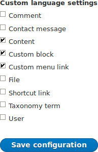
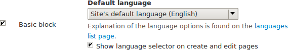
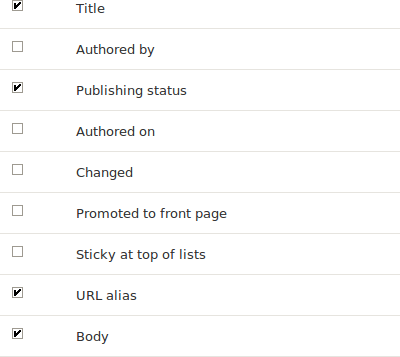

[[language-content-config]]

=== Configuración de la traducción de contenido

[role="summary"]
Cómo configurar los elementos de contenido para que sean traducibles.

(((Content,translation)))
(((Configuring,content translation)))

==== Objetivo

Hacer traducibles los tipos de entidad _Custom block_, _Custom menu link_ y
_Content_. Seleccionar subtipos concretos y definir qué campos de estos se
pueden traducir.

==== Conocimientos previos

* <<planning-data-types>>
* <<language-concept>>

==== Requisitos previos del sitio web

El módulo del núcleo Content Translation debe estar instalado y su sitio debe
tener al menos dos idiomas. Ver <<language-add>>.

==== Pasos

. En el menú administrativo _Manage_, vaya a _Configuration_ > _Regional
and language_ > _Content language and translation_
(_admin/config/regional/content-language_).

. En _Custom language settings_, marque _Content_, _Content block_ y _Custom
menu link_ para hacer traducibles estos tipos de entidad.
+
--
// Top section of Content language settings page
// (admin/config/regional/content-language).

--

. Aparecen opciones de configuración para _Content_, _Content block_ y _Custom
menu link_. Elija los subtipos que quiere traducir para cada tipo de entidad.
Marque _Basic page_ para _Content_, _Basic block_ para _Content block_ y
_Custom menu link_ para _Custom menu link_.

. Compruebe la configuración de los tipos de entidad como se muestra a
continuación:
+
[width="100%",frame="topbot",options="header"]
|================================
|Nombre del campo | Explicación | Valor de ejemplo
| Default language | El idioma predeterminado para el subtipo de entidad | Site's default language (English)
| Show language selector on create and edit pages | Si se debe mostrar o no el selector de idioma al editar y crear contenido | Marcado
|================================
+
--
// Main settings area for Content Block translations.

--

. Elija los campos que deben ser traducibles para _Basic page_ como se muestra
en la tabla siguiente. Si un campo no depende de la traducción, déjelo sin
marcar.
+
[width="100%",frame="topbot",options="header"]
|================================
|Nombre del campo | Explicación | Valor de ejemplo
| Title	| El título del contenido | Marcado
| Authored by | El autor | Sin marcar
| Published | Si el contenido se ha publicado o no | Marcado
| Authored on | Fecha de publicación | Sin marcar
| Changed | Fecha de la última actualización | Sin marcar
| Promoted to front page | Si el contenido se incluirá en algunas vistas de contenido | Sin marcar
| Sticky at top of lists | Si el contenido se mostrará primero en algunas vistas de contenido | Sin marcar
| URL alias | URL más amigable para el contenido | Marcado
| Body | El contenido principal de la página | Marcado
|================================
+
--
// Field settings area for Basic page translations.

--

. Del mismo modo, marque las casillas correspondientes a los campos traducibles
que pertenecen a _Basic block_ y _Custom menu link_.

. Haga clic en _Save configuration_.

==== Ampliar conocimiento

* <<language-config-translate>>
* <<language-content-translate>>

//==== Conceptos relacionados

==== Vídeos

// Video from Drupalize.Me.
video::https://www.youtube-nocookie.com/embed/b_w904_pcTY[title="Configuring Content Translation"]

==== Recursos adicionales

* http://hojtsy.hu/blog/2013-jun-21/drupal-8-multilingual-tidbits-5-almost-limitless-language-assignment[Blog post "Multilingual Drupal 8 tidbits, part 5"]

* http://hojtsy.hu/blog/2015-jan-27/drupal-8-multilingual-tidbits-17-content-translation-basics[Blog post "Multilingual Drupal 8 tidbits, part 17"]

*Atribuciones*

Escrito y editado por https://www.drupal.org/u/lolk[Laura Vass] en
https://pronovix.com/[Pronovix],
https://www.drupal.org/u/jojyja[Jojy Alphonso] en
http://redcrackle.com[Red Crackle],
y https://www.drupal.org/u/jhodgdon[Jennifer Hodgdon].

Traducido por https://www.drupal.org/u/juancasantito[Juan Santovenia].
