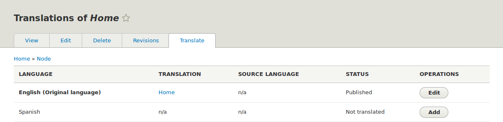

[[language-content-translate]]

=== Traducir contenido

[role="summary"]
Cómo traducir una página a otro idioma.

(((Content,translating)))
(((Translating,content)))

==== Objetivo

Traducir la página de inicio al español.

==== Conocimientos previos

<<language-concept>>

==== Requisitos previos del sitio web

* El contenido Home debe existir. Ver <<content-create>>.

* El módulo del núcleo Content Translation debe estar instalado y su sitio debe
tener al menos dos idiomas. Ver <<language-add>>.

* El tipo de contenido _Basic page_ debe estar configurado como traducible. Ver
<<language-content-config>>.

==== Pasos

. En el menú administrativo _Manage_, vaya a _Content_ (_admin/content_).

. Localice la página de inicio. Puede buscarla escribiendo "Home" en el campo
de título.

. Seleccione _Translate_ en el botón desplegable de la fila del elemento de
contenido Home. Aparece la página _Translations of Home_.

. Haga clic en _Add_ en la fila _Spanish_.
+
--
// Screenshot of the translations page for the Home page content item.

--

. Tenga en cuenta que la interfaz de usuario ha cambiado al español. Para
volver a cambiarla al inglés, elimine la primera aparición de _es_ en la URL
del navegador. Por ejemplo, si su URL se parece a
_example.com/es/node/5/translations/add/en/es_, elimine el _es_ que aparece
inmediatamente después de _example.com_.

. Rellene los campos como se muestra a continuación.
+
[width="100%",frame="topbot",options="header"]
|================================
|Nombre del campo | Explicación | Valor
|Title | Título traducido de la página | Página principal
|Body | Cuerpo traducido de la página |
Bienvenido al mercado de la ciudad - ¡el mercado de agricultores de tu barrio!
Horario: Domingos de 9:00 a 14:00. Desde Abril a Septiembre
Lugar: parking del Banco Trust número 1. En el centro de la ciudad
|URL alias > URL alias | Dirección traducida de la página web | pagina-principal
|================================

. Haga clic en _Save (this translation)_.

. Vaya a la página de inicio de su sitio para ver la página recién traducida.

==== Ampliar conocimiento

* Siga los pasos anteriores para traducir más contenido de su sitio.

* <<language-config-translate>>

// ==== Conceptos relacionados

==== Vídeos

// Video from Drupalize.Me.
video::https://www.youtube-nocookie.com/embed/TOalcUYD5zM[title="Translating Content"]

// ==== Recursos adicionales

*Atribuciones*

Escrito por https://www.drupal.org/u/batigolix[Boris Doesborg].

Traducido por https://www.drupal.org/u/juancasantito[Juan Santovenia].
