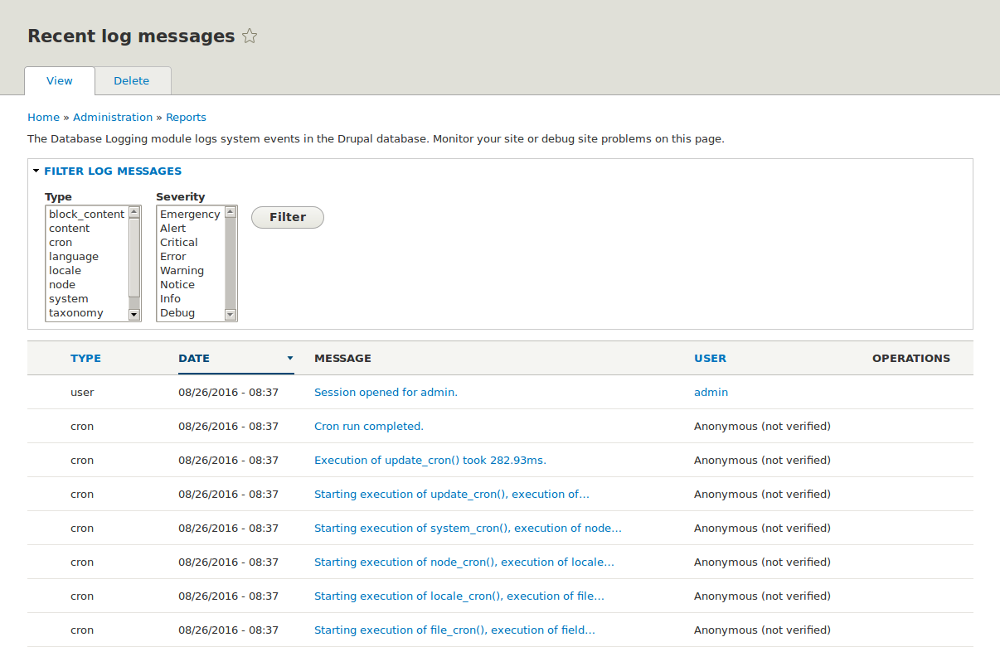

[[prevent-log]]

=== Concepto: log

[role="summary"]
Descripción general de los logs y dónde encontrar los mensajes de registro
recientes.

(((Log,overview)))
(((Report,Recent log messages)))
(((Error,log report)))
(((Troubleshooting,log report)))
(((Performance,log report)))

//==== Prerequisite knowledge

==== ¿Qué es un log?

Su sitio captura los eventos del sistema en un log para que una persona
autorizada los revise más adelante. El log es una lista de eventos registrados
que contiene datos de uso, datos de rendimiento, errores, avisos e información
operativa. Es vital revisar el log de forma periódica, ya que a menudo es la
única manera de saber qué está ocurriendo.

Puede encontrar los mensajes de registro recientes de su sitio en el menú
administrativo _Manage_ navegando a _Reports_ > _Recent log messages_
(_admin/reports/dblog_). Estos logs pueden ser borrados por los
administradores y por las tareas de cron automatizadas, así que no deberían
usarse para el https://en.wikipedia.org/wiki/Audit_trail[registro forense].
Para fines forenses, use el módulo Syslog.

// Recent log messages report (admin/reports/dblog).

//==== Related topics

//==== Additional resources

*Atribuciones*

Adaptado por https://www.drupal.org/u/dianalakatos[Diána Lakatos]
de https://www.drupal.org/docs/7/monitoring-a-site/reports["Reports"]
copyright 2000-copyright_upper_year por los colaboradores individuales de la
https://www.drupal.org/documentation[Documentación de la Comunidad de Drupal]

Traducido por https://www.drupal.org/u/juancasantito[Juan Santovenia]
