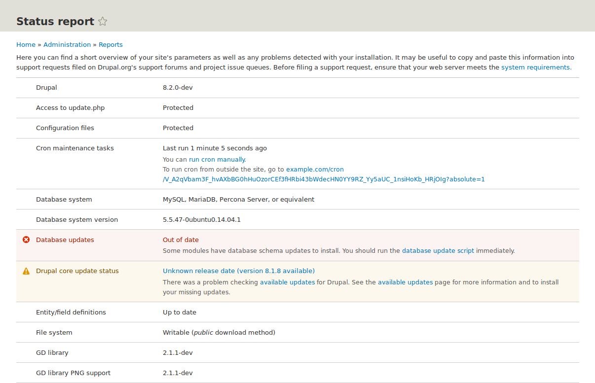

[[prevent-status]]

=== Concepto: informe de estado

[role="summary"]
Descripción general del informe de estado y dónde encontrarlo en un sitio web.

(((Status report,overview)))
(((Security,status report)))
(((PHP version,status report)))
(((Software version,status report)))
(((Update status,status report)))
(((Update,status report)))
(((Site information,status report)))
(((Server information,status report)))
(((Performance,status report)))
(((Troubleshooting,status report)))

//==== Prerequisite knowledge

==== ¿Qué es un informe de estado?

El informe de estado es una breve descripción general de los parámetros de su
sitio, así como de cualquier problema detectado en su instalación. Puede ser
útil copiar y pegar esta información en las solicitudes de soporte presentadas
en los foros de soporte de _Drupal.org_ y en las colas de incidencias del
proyecto, o al pedir ayuda por otros canales.

Puede encontrar el informe de estado en el menú administrativo _Manage_
navegando a _Reports_ > _Status report_ (_admin/reports/status_).

// Status report (admin/reports/status).

==== Temas relacionados

<<thoughts-support>>

==== Recursos adicionales

Si en su informe de estado aparece un error sobre la configuración de hosts de
confianza (_trusted host settings_), ver
https://www.drupal.org/docs/installing-drupal/trusted-host-settings[_Drupal.org_ community documentation page "Trusted Host settings"].

*Atribuciones*

Adaptado por https://www.drupal.org/u/dianalakatos[Diána Lakatos]
de https://www.drupal.org/docs/7/monitoring-a-site/reports["Reports"]
copyright 2000-copyright_upper_year por los colaboradores individuales de la
https://www.drupal.org/documentation[Documentación de la Comunidad de Drupal]

Traducido por https://www.drupal.org/u/juancasantito[Juan Santovenia].
