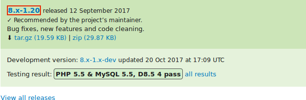
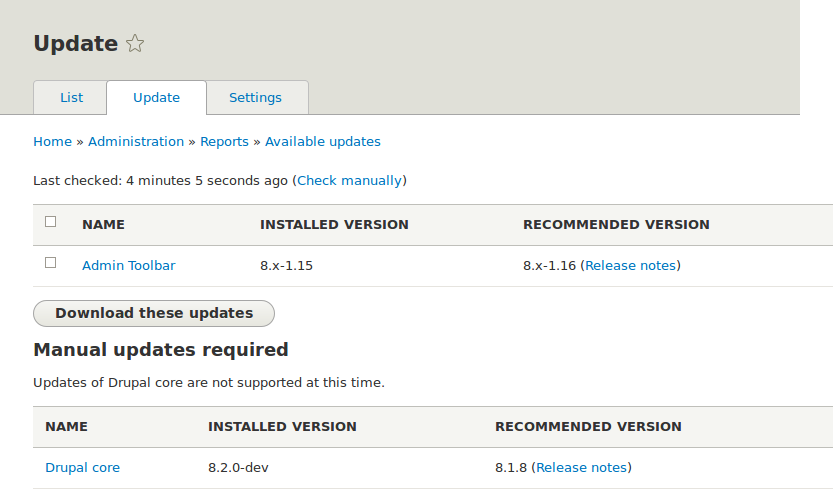

[[security-update-module]]

=== Actualización de un módulo

[role="summary"]
Cómo actualizar un módulo contribuido utilizando Composer y la interfaz
administrativa para ejecutar el script de actualizaciones de la base de datos.

(((Module,updating)))
(((Security update,applying)))
(((Contributed module,updating)))

==== Objetivo

Actualizar un módulo contribuido y ejecutar el script _Database updates_.

==== Conocimientos previos

* <<security-concept>>
* <<security-cron-concept>>

==== Requisitos previos del sitio web

* Se ha instalado un módulo contribuido y hay una actualización disponible para
él. Ver <<extend-module-install>> y <<security-announce>>.

* Si su sitio está en producción, debería probar este proceso en un entorno de
desarrollo antes de ejecutarlo en su sitio de producción. Ver
<<install-dev-making>>.

* Ha creado una copia de seguridad completa del sitio. Ver <<prevent-backups>>.

* Si quiere usar la interfaz de usuario para comprobar si hay actualizaciones,
debe estar instalado el módulo del núcleo Update Manager. Ver <<config-install>>
para obtener instrucciones sobre la instalación de módulos del núcleo.

==== Pasos

Antes de empezar, compruebe si hay instrucciones de actualización específicas
del módulo. Lea y comprenda todos los requisitos específicos del módulo antes
de continuar con las actualizaciones. Para encontrar las instrucciones,
consulte el enlace _Read Documentation_ de la página del proyecto del módulo.

Para ver más instrucciones, después de descargar los archivos actualizados,
busque los archivos _README.txt_, _INSTALL.txt_ y _UPGRADE.txt_ que vienen con
el módulo. Además, revise las notas de la versión en la página del proyecto
haciendo clic en el número de versión que está descargando.

// Downloads section of the Admin Toolbar project page on drupal.org.

Actualizar un módulo requiere primero poner su sitio en modo de mantenimiento,
después obtener los nuevos archivos de código y aplicar las actualizaciones de
base de datos necesarias y, por último, sacar el sitio del modo de
mantenimiento.

Puede actualizar el código de un módulo contribuido utilizando Composer. Si
está actualizando un módulo personalizado en lugar de un módulo contribuido,
obtenga los nuevos archivos del módulo y después continúe con las instrucciones
para ejecutar las actualizaciones de base de datos mediante la interfaz
administrativa que se indican más abajo.

Esto asume que está utilizando Composer para gestionar los archivos de su
sitio; ver <<install-composer>>.

===== Actualizar un módulo contribuido con Composer

. Ponga su sitio en modo de mantenimiento. Ver <<extend-maintenance>>.

. En el menú administrativo _Manage_, vaya a _Reports_ >
_Available updates_ > _Update_ (_admin/reports/updates_).

. Busque y marque el módulo en la lista. Haga clic en _Download these updates_
para el módulo.
+
--
// Update page for theme (admin/reports/updates/update).

--

. Determine el nombre corto del proyecto que quiere actualizar. Para los
módulos y temas contribuidos, es la última parte de la URL de la página del
proyecto; por ejemplo, el módulo Geofield, en
https://www.drupal.org/project/geofield, tiene el nombre corto +geofield+.

. Si quiere actualizar a la última versión estable, utilice el siguiente
comando, sustituyendo +geofield+ por el nombre corto del proyecto que se va a
actualizar:
+
----
composer update drupal/geofield --with-dependencies
----
+
Para saber cómo descargar versiones concretas, ver <<install-composer>>.

. Después de obtener los nuevos archivos del módulo, ejecute las
actualizaciones de base de datos escribiendo la URL _example.com/update.php_ en
su navegador.

. Haga clic en _Continue_ para ejecutar las actualizaciones. Se ejecutarán los
scripts de actualización de la base de datos.

. Haga clic en _Administration pages_ para volver a la sección de
administración de su sitio.

. Saque su sitio del modo de mantenimiento. Ver <<extend-maintenance>>.

. Borre la caché de Drupal (consulte <<prevent-cache-clear>>).

==== Ampliar conocimiento

* Revise el registro del sitio (consulte <<prevent-log>>) una vez completadas
las actualizaciones para comprobar si hay errores.

* <<security-update-theme>>

//==== Related concepts

==== Vídeos

// Video from Drupalize.Me.
video::https://www.youtube-nocookie.com/embed/wxWW-lPQ_Pc[title="Updating a Module"]

// ==== Additional resources

*Atribuciones*

Adaptado por https://www.drupal.org/u/batigolix[Boris Doesborgh] y
https://www.drupal.org/u/hey_germano[Sarah German] en
https://www.advomatic.com[Advomatic], y
https://www.drupal.org/u/eojthebrave[Joe Shindelar] en https://drupalize.me[Drupalize.Me]
de https://www.drupal.org/docs/7/update/updating-modules["Update modules"],
copyright 2000-copyright_upper_year por los colaboradores individuales de la
https://www.drupal.org/documentation[Documentación de la Comunidad de Drupal].

Traducido por https://www.drupal.org/u/juancasantito[Juan Santovenia].
