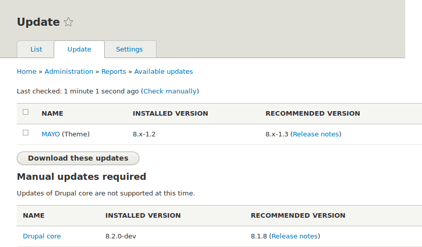

[[security-update-theme]]

=== Actualización de un tema

[role="summary"]
Cómo actualizar un tema contribuido utilizando Composer y la interfaz
administrativa para ejecutar el script de actualizaciones de la base de datos.

(((Theme,updating)))
(((Security update,applying)))
(((Contributed theme,updating)))

==== Objetivo

Actualizar un tema contribuido en su sitio y ejecutar el script _Database
Updates_.

==== Conocimientos previos

* <<security-concept>>
* <<security-cron-concept>>

==== Requisitos previos del sitio web

* Se ha instalado un tema contribuido y hay una actualización disponible para
él. Ver <<extend-theme-install>> y <<security-announce>>.

* Si su sitio está en producción, debería probar este proceso en un entorno de
desarrollo antes de ejecutarlo en su sitio de producción. Ver
<<install-dev-making>>.

* Ha creado una copia de seguridad completa del sitio. Ver <<prevent-backups>>.

* Si desea utilizar la interfaz de usuario para comprobar si hay
actualizaciones, debe estar instalado el módulo Update Manager del núcleo. Ver
<<config-install>> para obtener instrucciones sobre la instalación de módulos
del núcleo.

==== Pasos

Actualizar un tema contribuido requiere primero poner su sitio en modo de
mantenimiento, después obtener los nuevos archivos de código y aplicar las
actualizaciones de base de datos necesarias y, por último, sacar el sitio del
modo de mantenimiento.

Puede actualizar el código de un tema contribuido utilizando Composer. Si está
actualizando un tema personalizado en lugar de un tema contribuido, obtenga los
nuevos archivos del tema y después continúe con las instrucciones para ejecutar
las actualizaciones de base de datos mediante la interfaz administrativa que se
indican más abajo.

Esto asume que está utilizando Composer para gestionar los archivos de su
sitio; ver <<install-composer>>.

===== Actualizar un tema contribuido con Composer

. Ponga su sitio en modo de mantenimiento. Ver <<extend-maintenance>>.

. En el menú administrativo _Manage_, vaya a _Reports_ >
_Available updates_ > _Update_ (_admin/reports/updates_).

. Busque en la lista los temas que necesiten actualizarse.
+
// Update page for theme (admin/reports/updates/update).

. Determine el nombre corto del proyecto que quiere actualizar. Para los
módulos y temas contribuidos, es la última parte de la URL de la página del
proyecto; por ejemplo, el tema Honey, en https://www.drupal.org/project/honey,
tiene el nombre corto +honey+.

. Si quiere actualizar a la última versión estable, utilice el siguiente
comando, sustituyendo +honey+ por el nombre corto del proyecto que se va a
actualizar:
+
----
composer update drupal/honey --with-dependencies
----
+
Para saber cómo descargar versiones concretas, ver <<install-composer>>.

. Después de obtener los nuevos archivos del tema, ejecute las actualizaciones
de base de datos escribiendo la URL _example.com/update.php_ en su navegador.

. Haga clic en _Continue_ para ejecutar las actualizaciones. Se ejecutarán los
scripts de actualización de la base de datos.

. Haga clic en _Administration pages_ para volver a la sección de
administración de su sitio.

. Saque su sitio del modo de mantenimiento. Ver <<extend-maintenance>>.

. Borre la caché de Drupal (consulte <<prevent-cache-clear>>).

==== Ampliar conocimiento

* Revise el registro del sitio, ver <<prevent-log>>, una vez completadas las
actualizaciones para comprobar si hay errores.

* <<security-update-module>>

// ==== Conceptos relacionados

==== Vídeos

// Video from Drupalize.Me.
video::https://www.youtube-nocookie.com/embed/elVnWoaQMkk[title="Updating a Theme"]

// ==== Recursos adicionales

*Atribuciones*

Escrito por https://www.drupal.org/u/batigolix[Boris Doesborg] y
https://www.drupal.org/u/eojthebrave[Joe Shindelar] en https://drupalize.me[Drupalize.Me].

Traducido por https://www.drupal.org/u/juancasantito[Juan Santovenia].
