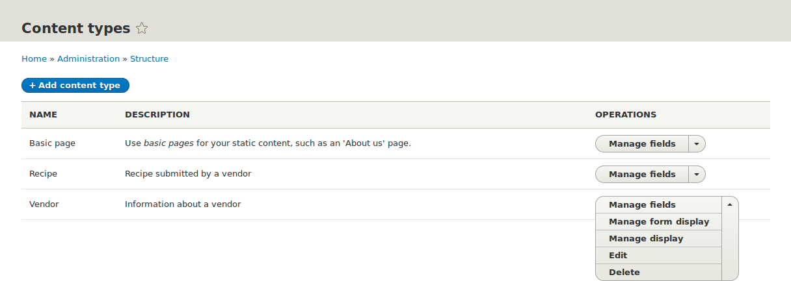
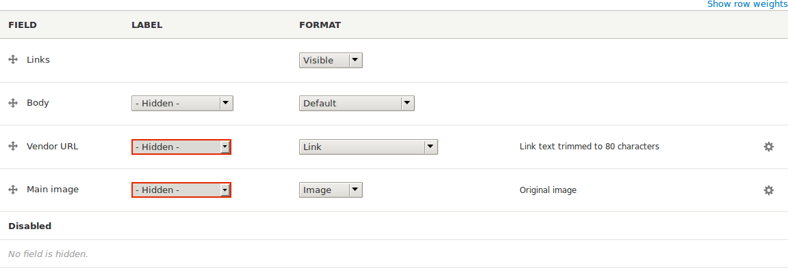
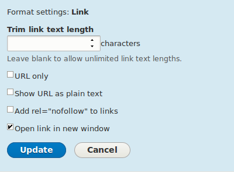
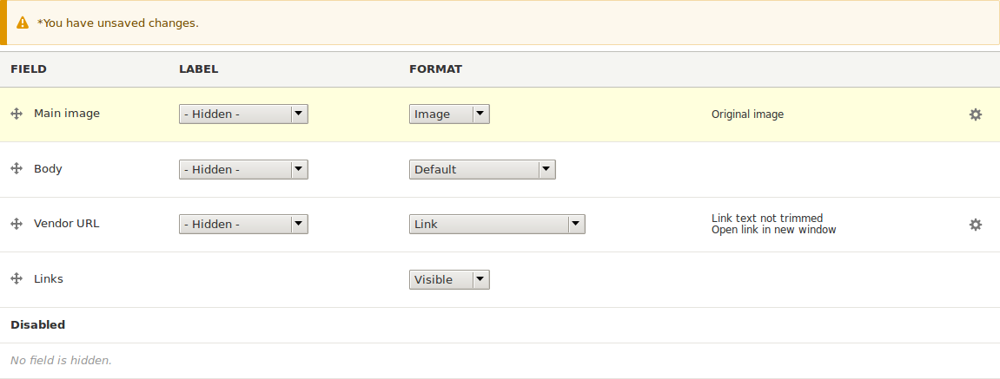

[[structure-content-display]]

=== Cambiar la visualización del contenido

[role="summary"]
Cómo hacer que los elementos de contenido sean más presentables.

(((Content display,changing)))
(((Content display,managing)))
(((Content,displaying)))

==== Objetivo

Hacer que los elementos de contenido sean más legibles, accesibles y
visualmente atractivos reordenando los campos, ocultando etiquetas y ajustando
la salida de los campos.

==== Conocimientos previos

* <<planning-data-types>>
* <<structure-view-modes>>

==== Requisitos previos del sitio web

El tipo de contenido Vendor debe existir, debe tener los campos Main Image y
Vendor URL, y su sitio debe tener al menos un elemento de contenido Vendor. Ver
<<structure-content-type>>, <<structure-fields>> y <<content-create>>.

==== Pasos

. Busque y vea un elemento de contenido Vendor que creó en <<structure-fields>>.
Observe que hay varias cosas que se podrían hacer para mejorar el aspecto de la
página:
+
  * Los campos Main Image y Vendor URL no deberían tener etiquetas.
  * Habría que cambiar el orden de los campos para que la imagen aparezca
  primero.
  * La imagen debería ser más pequeña.

. Para corregir los dos primeros problemas y actualizar algunos ajustes
adicionales, en el menú administrativo _Manage_, vaya a _Structure_ > _Content
types_ (_admin/structure/types_). Después haga clic en _Manage display_ en el
botón desplegable del tipo de contenido Vendor.
+
--
// Content types list on admin/structure/types, with operations dropdown
// for Vendor content type expanded.

--

. En la columna _Label_, seleccione _Hidden_ para Main image. Haga lo mismo con
Vendor URL.
+
--
// Manage display page for Vendor content type
// (admin/structure/types/manage/vendor/display), with labels for Main
// Image and Vendor URL hidden, and their select lists outlined in red.

--

. Haga clic en la rueda dentada del campo Vendor URL para abrir las opciones de
configuración.

. Rellene los campos como se muestra a continuación.
+
[width="100%",frame="topbot",options="header"]
|================================
|Nombre del campo|Explicación|Valor de ejemplo
|Trim link text length| Longitud máxima que se muestra del texto del enlace| En blanco (sin recorte)
|Open link in new window| Si los enlaces deben abrirse en una ventana nueva o en la misma ventana |Marcado
|================================
+
--
// Vendor URL settings form, with trim length cleared, and open link in
// new window checked.

--

. Haga clic en _Update_.

. Arrastre los tiradores en cruz de los campos para reordenarlos como Main
image, _Body_, Vendor URL y _Links_. Como alternativa a arrastrar, puede hacer
clic en el enlace _Show row weights_ situado en la parte superior de la tabla e
introducir pesos numéricos (los campos con pesos menores o más negativos se
mostrarán primero).
+
--
// Manage display page for Vendor content type, with order changed.

--

. Haga clic en _Save_.

. Vuelva a buscar el elemento de contenido Vendor del paso 1 y compruebe que se
han aplicado las actualizaciones.

. Repita pasos similares para gestionar la visualización de los campos del tipo
de contenido Recipe.

==== Ampliar conocimiento

* Haga la imagen principal más pequeña. Ver <<structure-image-style-create>>.

* Si no ve el efecto de estos cambios en su sitio, puede que tenga que borrar
la caché. Ver <<prevent-cache-clear>>.

==== Conceptos relacionados

<<structure-image-styles>>

==== Vídeos

// Video from Drupalize.Me.
video::https://www.youtube-nocookie.com/embed/myYI9rhF_4o[title="Changing Content Display"]

==== Recursos adicionales

* https://www.drupal.org/docs/7/nodes-content-types-and-fields/specify-how-fields-are-displayed[_Drupal.org_ community documentation page "Specify how fields are displayed"]
* https://www.drupal.org/docs/7/nodes-content-types-and-fields/rearrange-the-order-of-fields[_Drupal.org_ community documentation page "Rearrange the order of fields"]
* https://www.drupal.org/node/1577752[_Drupal.org_ community documentation page "View modes"]

*Atribuciones*

Escrito por https://www.drupal.org/u/AnnGreazel[Ann Greazel] y
https://www.drupal.org/u/batigolix[Boris Doesborg].

Traducido por https://www.drupal.org/u/juancasantito[Juan Santovenia].
