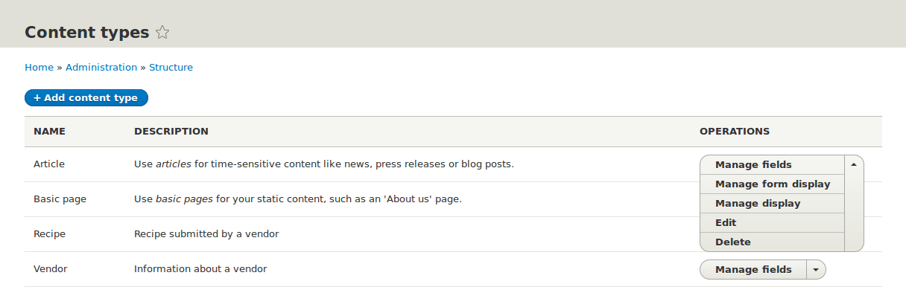
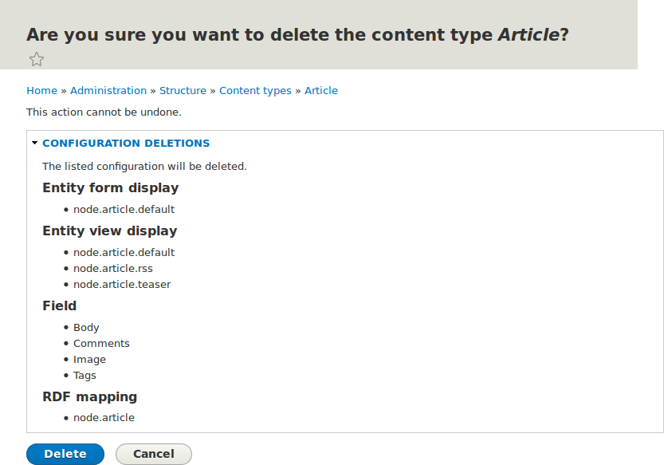

[[structure-content-type-delete]]

=== Eliminar un tipo de contenido

[role="summary"]
Cómo eliminar un tipo de contenido que no es necesario para el sitio.

(((Content type,deleting)))

==== Objetivo

Eliminar el tipo de contenido innecesario _Article_.

==== Conocimientos previos

<<config-overview>>

==== Requisitos previos del sitio web

El tipo de contenido _Article_ debe existir. Se crea en su sitio cuando instala
con el perfil de instalación Standard del núcleo.

==== Pasos

. En el menú administrativo _Manage_, vaya a _Structure_ > _Content types_
(_admin/structure/types_). Aparece la página _Content types_.

. Haga clic en _Delete_ en el botón desplegable _Operations_ del tipo de
contenido _Article_. Tenga en cuenta que el nombre de este tipo de contenido
aparece en inglés en esta página; ver <<language-concept>> para una
explicación.
+
--
// Content types list on admin/structure/types, with operations dropdown
// for Article content type expanded.

--

. Se muestra una página de confirmación. Haga clic en _Delete_.
+
--
// Confirmation page for deleting Article content type.

--

. Aparece la página _Content types_ con un mensaje de confirmación que indica
que el tipo de contenido se ha eliminado:
+
--
// Confirmation message after deleting Article content type.

--

//==== Expand your understanding

// ==== Related concepts

==== Vídeos

// Video from Drupalize.Me.
video::https://www.youtube-nocookie.com/embed/1627xZFcJCY[title="Deleting a Content Type"]

//==== Additional resources

*Atribuciones*

Escrito y editado por https://www.drupal.org/u/sree[Sree Veturi]
y https://www.drupal.org/u/batigolix[Boris Doesborg].

Traducido por https://www.drupal.org/u/juancasantito[Juan Santovenia].
