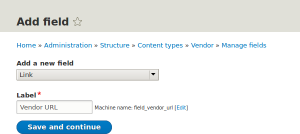
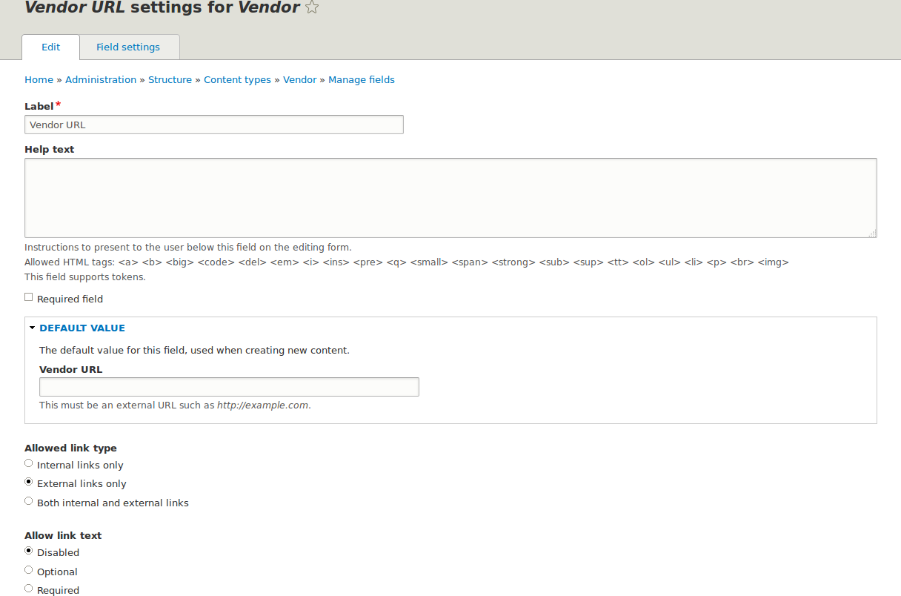
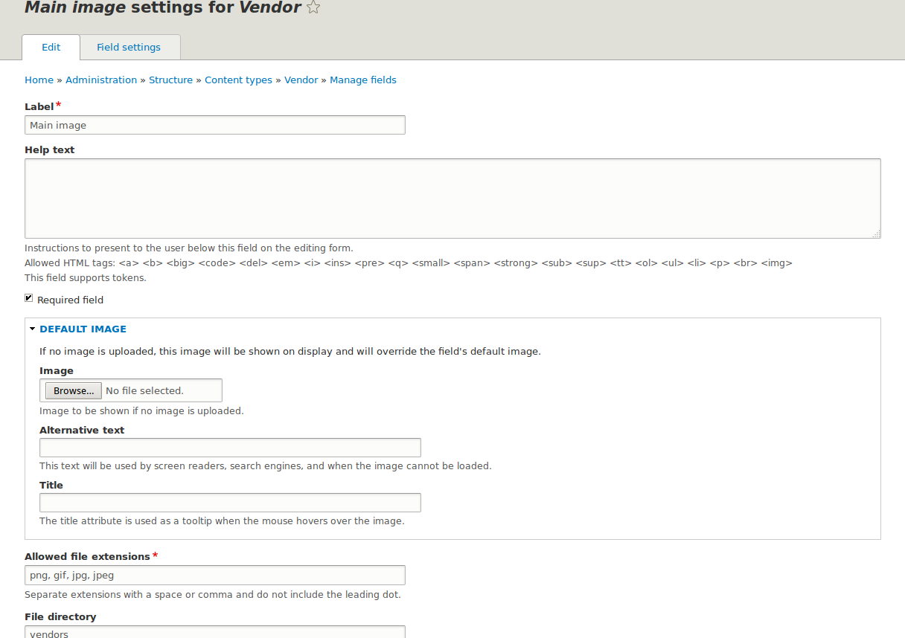
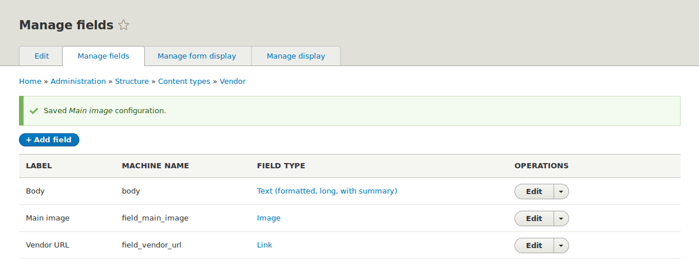

[[structure-fields]]

=== Añadir campos básicos a un tipo de contenido

[role="summary"]
Cómo añadir campos a un tipo de contenido.

(((Content type,adding field to)))
(((Field,adding to content type)))
(((Image field,adding)))
(((URL field,adding)))

==== Objetivo

Añadir un campo de enlace y un campo de imagen al tipo de contenido Vendor.

==== Conocimientos previos

<<planning-data-types>>

==== Requisitos previos del sitio web

El tipo de contenido Vendor debe existir. Ver <<structure-content-type>>.

==== Pasos

Añade los campos Vendor URL e Main image al tipo de contenido Vendor.

. En el menú administrativo _Manage_, ve a _Structure_ > _Content types_
(_admin/structure/types_). A continuación, haz clic en _Manage fields_ en el
botón desplegable del tipo de contenido Vendor. Aparece la página _Manage
fields_. Desde aquí puedes crear un nuevo campo para el tipo de contenido o
reutilizar un campo existente. Ten en cuenta que los nombres y descripciones de
los tipos de contenido y campos que proporciona tu perfil de instalación se
muestran en inglés en estas páginas; ver <<language-concept>> para una
explicación.

. Haz clic en _Create a new field_. Aparece la página _Add field_.
+
--
// Initial page for admin/structure/types/manage/vendor/fields/add-field.

--

. Elige el tipo de campo _Link_ en las opciones _Choose a field type_. Haz clic
en _Continue_. Aparece la página _Add field_ con un formulario para configurar
la etiqueta del campo.

. Rellena los campos como se muestra a continuación.
+
[width="100%",frame="topbot",options="header"]
|================================
| Nombre del campo | Explicación | Valor
| Label | Etiqueta visible en las páginas de administración | Vendor URL
| Choose a type of field | Tipo de campo | Link
|================================
+
Se genera automáticamente un nombre de máquina basado en el valor de _Label_.
Haz clic en _Edit_ si quieres anular el nombre por defecto.
+
--
// Second page for admin/structure/types/manage/vendor/fields/add-field.
image:images/structure-fields-add-field-label.png["Add field page to set field label"]
--

. Haz clic en _Continue_. Aparece la página _Vendor URL settings for Vendor_,
que te permite configurar el campo. Rellena los campos como se muestra a
continuación.
+
[width="100%",frame="topbot",options="header"]
|================================
|Nombre del campo | Explicación | Valor
| Label  | Etiqueta visible en el formulario de contenido | Vendor URL
| Allowed number of values | El número de valores que se pueden introducir | Limited, 1
| Help text | La instrucción que se muestra debajo del campo | (dejar en blanco)
| Required field | Si el campo es obligatorio o no | Sin marcar
| Allowed link type | El tipo de enlaces que se pueden introducir | External links only
| Allow link text | Si se puede introducir texto del enlace | Disabled
|================================
+
--
// Field settings page for adding vendor URL field.

--

. Haz clic en _Save settings_. Se ha añadido Vendor URL al tipo de contenido.
Continúa creando el campo Main image.

. Haz clic en _Create a new field_. Aparece la página _Add field_.

. Elige el tipo de campo _File upload_ en las opciones _Choose a field type_.
Haz clic en _Continue_. Aparece la página _Add field_ con un formulario para
configurar la etiqueta del campo.

. Algunos tipos de campo requieren la selección de un subtipo. Rellena los
campos como se muestra a continuación.
+
[width="100%",frame="topbot",options="header"]
|================================
| Nombre del campo | Explicación | Valor
| Label | Etiqueta visible en las páginas de administración | Main image
| Choose an option below | Subtipo de campo | Image
|================================

. Haz clic en _Continue_. Aparece la página Main image settings for Vendor.
Rellena los campos como se muestra a continuación.
+
[width="100%",frame="topbot",options="header"]
|================================
| Nombre del campo | Explicación | Valor
| Label  | Etiqueta visible en el formulario de contenido | Main image
| Allowed number of values | El número de valores que se pueden introducir | Limited, 1
| Default image | Puedes establecer una imagen por defecto aquí. Se usará cuando no proporciones una imagen al crear un elemento de contenido Vendor. | (dejar en blanco)
| Help text | La instrucción que se muestra debajo del campo | (dejar en blanco)
| Required field | Si el campo es obligatorio o no | Checked
| Allowed file extensions | El tipo de imágenes que se pueden subir | png, gif, jpg, jpeg
| File directory | El directorio donde se almacenarán los archivos. Al proporcionar un valor de directorio de archivo, garantizas que todas las imágenes subidas a través del campo Main image se ubicarán en el mismo directorio. | vendors
| Minimum image dimensions | Las dimensiones mínimas de la imagen subida | 600 x 600
| Maximum upload size | El tamaño máximo de archivo de la imagen subida | 5 MB
| Enable Alt field | Si se puede introducir un texto alternativo | Checked
| Alt field required | Si el texto alternativo es obligatorio | Checked
|================================
+
--
// Field settings page for adding main image field.

--

. Haz clic en _Save settings_. Se ha añadido Main image al tipo de contenido.
+
--
// Manage fields page for Vendor, showing two new fields.

--

. Añade un campo Main image al tipo de contenido Recipe, usando pasos similares.
Comienza navegando a la página _Manage Fields_ del tipo de contenido Recipe.
Luego usa el botón _Re-use an existing field_ para abrir el diálogo modal y
presiona el botón _Re-use_ que corresponde al campo Main image en la tabla. A
continuación salta al paso 7 y sigue los pasos restantes.
+
--
// Modal dialog with list of fields to re-use.
image:images/structure-fields-main-img-reuse.png["Select a field to re-use",width="100%"]
--

. Crea dos elementos de contenido Vendor (ver <<content-create>>) llamados
"Happy Farm" y "Sweet Honey". Asegúrate de que incluyen imágenes y URLs.

==== Ampliar conocimiento

* <<structure-image-styles>>
* <<structure-content-display>>
* <<structure-form-editing>>

// ==== Related concepts

==== Vídeos

// Video from Drupalize.Me.
video::https://www.youtube-nocookie.com/embed/CZpfR9WbVcQ[title="Adding Basic Fields to a Content Type"]

==== Recursos adicionales

https://www.drupal.org/docs/7/nodes-content-types-and-fields/add-a-field-to-a-content-type[Página de documentación comunitaria de _Drupal.org_ "Add a field to a content type"]

*Atribuciones*

Escrito por https://www.drupal.org/u/sree[Sree Veturi] y
https://www.drupal.org/u/batigolix[Boris Doesborg], y https://www.drupal.org/u/eojthebrave[Joe Shindelar] en https://drupalize.me[Drupalize.Me].

Traducido por https://www.drupal.org/u/alvar0hurtad0[Alvaro Hurtado].
