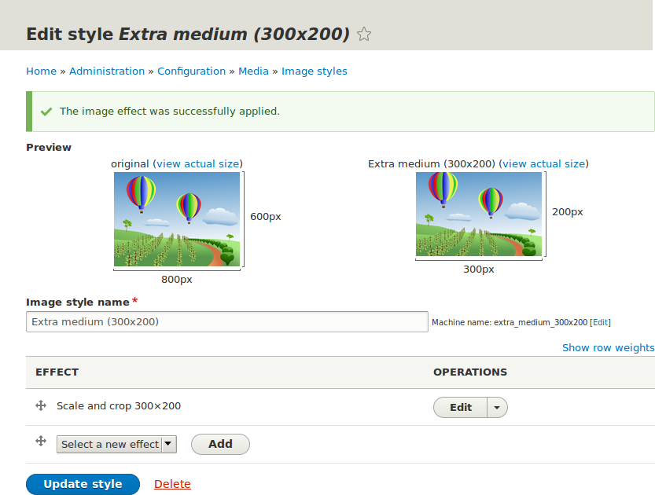
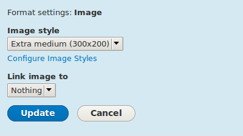

[[structure-image-style-create]]

=== Configuración de un estilo de imagen

[role="summary"]
Cómo añadir un estilo de imagen para reformatear una imagen.

(((Image style,creating)))
(((Style,image)))
(((Effect,image)))
(((Image,resizing)))

==== Objetivo

Añadir un estilo de imagen y utilizarlo para mostrar imágenes en las páginas de
Vendor.

==== Conocimientos previos

* <<structure-fields>>
* <<structure-content-display>>
* <<structure-image-styles>>

==== Requisitos previos del sitio web

* Los tipos de contenido Vendor y Recipe deben existir. Ver
<<structure-content-type>>.

* Deben existir campos de imagen principal para ambos tipos de contenido. Ver
<<structure-fields>>.

* Deben existir elementos de contenido para ambos tipos de contenido. Ver
<<structure-content-type>>, <<structure-fields>> y <<content-create>>.

==== Pasos

. En el menú administrativo _Manage_, vaya a _Configuration_ > _Media_ >
_Image styles_ (_admin/config/media/image-styles_).

. Haga clic en _Add image style_.

. Introduzca el nombre _Extra medium (300x200)_.

. Haga clic en _Create new style_. Aparece la página _Edit style Extra medium
(300x200)_.

. En la tabla _Effect_, seleccione _Scale and crop_. Haga clic en _Add_.

. Rellene los campos como se muestra a continuación.
+
[width="100%",frame="topbot",options="header"]
|================================
|Nombre del campo | Valor
|Width | 300
|Height | 200
|================================

. Haga clic en _Add effect_. El estilo de imagen se guarda con los efectos
elegidos.
+
--
// Image style editing page, with effects added.

--

. En el menú administrativo _Manage_, vaya a _Structure_ > _Content types_
(_admin/structure/types_).

. Haga clic en _Manage display_ en el desplegable _Operations_ del tipo de
contenido Vendor. Aparece la página _Manage display_
(_admin/structure/types/manage/vendor/display_).

. Asegúrese de que está seleccionada la pestaña secundaria _Default_.

. Haga clic en la rueda dentada del campo _Main image_ para abrir las opciones
de configuración.

. Rellene los campos como se muestra a continuación.
+
[width="100%",frame="topbot",options="header"]
|================================
|Nombre del campo | Explicación | Valor de ejemplo
|Image style | Qué estilo de imagen usar | Extra medium (300x200)
|Link image to | Página a la que ir si se hace clic en la imagen | Nothing
|================================
+
--
// Main image settings area of Vendor content type.

--

. Haga clic en _Update_.

. Haga clic en _Save_. El nuevo estilo de imagen se utilizará al mostrar el
contenido Vendor.

. Abra un elemento de contenido Vendor y compruebe que ahora se muestra con la
imagen a escala reducida. Ver <<content-edit>> para más información sobre cómo
localizar un elemento de contenido existente.

. Repita los pasos 8-15 para el tipo de contenido Recipe.

// ==== Expand your understanding

==== Conceptos relacionados

* <<structure-fields>>
* <<structure-image-styles>>
* <<structure-image-responsive>>

==== Vídeos

// Video from Drupalize.Me.
video::https://www.youtube-nocookie.com/embed/DKIo7j19ulY[title="Setting up an Image Style"]

==== Recursos adicionales

https://www.drupal.org/docs/core-modules-and-themes/core-modules/image-module/working-with-images[_Drupal.org_ community documentation page "Working with images"]

*Atribuciones*

Adaptado y editado por https://www.drupal.org/u/batigolix[Boris Doesborg] y
https://www.drupal.org/u/jojyja[Jojy Alphonso] en
http://redcrackle.com[Red Crackle], de
https://www.drupal.org/docs/core-modules-and-themes/core-modules/image-module/working-with-images["Working with images"],
copyright 2000-copyright_upper_year por los colaboradores individuales de la
https://www.drupal.org/documentation[Documentación de la Comunidad de Drupal].

Traducido por https://www.drupal.org/u/juancasantito[Juan Santovenia].
