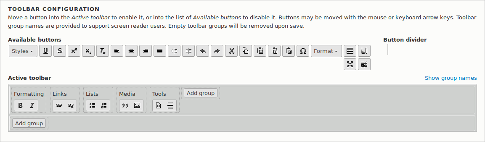
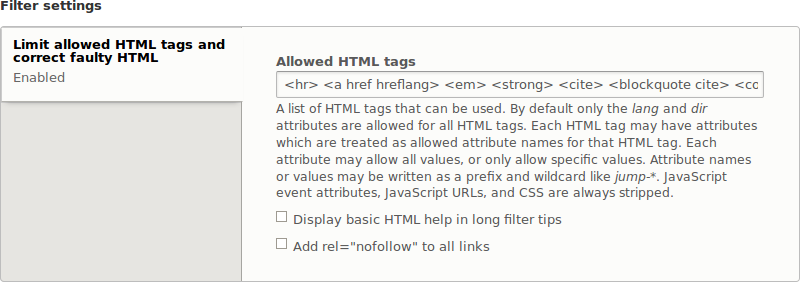

[[structure-text-format-config]]

=== Configuración de formatos de texto y editores

[role="summary"]
Cómo hacer un cambio en un formato de texto y en la configuración de su editor.

(((Text format,configuring)))
(((Configuring,text format)))
(((Editor,configuring)))
(((CKEditor text editor,default assignment to text format)))
(((WYSIWYG (What You See Is What You Get),configuring editor)))
(((What You See Is What You Get (WYSIWYG),configuring editor)))
(((Module,Filter)))
(((Module,Editor)))
(((Module,CKEditor)))
(((Filter module,configuring)))
(((Editor module,configuring)))
(((CKEditor module,configuring)))

==== Objetivo

Añadir una etiqueta de regla horizontal al formato de texto _Basic HTML_ y un
botón correspondiente a la configuración de su editor.

==== Conocimientos previos

<<structure-text-formats>>

==== Requisitos previos del sitio web

* Los módulos del núcleo Filter, Editor y CKEditor deben estar instalados. Se
instalan en su sitio cuando instala con el perfil de instalación Standard del
núcleo.

* El formato de texto _Basic HTML_ debe existir. Se crea en su sitio cuando
instala con el perfil de instalación Standard del núcleo.

==== Pasos

. En el menú administrativo _Manage_, vaya a _Configuration_ > _Content
authoring_ > _Text formats and editors_ (_admin/config/content/formats_).
Aparece la página _Text formats and editors_. Tenga en cuenta que los nombres
de los formatos de texto que venían con su perfil de instalación se muestran en
inglés en esta página; ver <<language-concept>> para una explicación.

. Haga clic en _Configure_ en el formato de texto _Basic HTML_. Aparece la
página _Basic HTML_.

. Observe que _CKEditor_ está seleccionado en el campo _Text editor_. Esto le
permite configurar la barra de herramientas del editor.

. Arrastre el botón _horizontal line_ desde _Available buttons_ a la _Active
toolbar_. Los elementos de la barra de herramientas se pueden agrupar
visualmente mediante un separador vertical. Como alternativa a arrastrar, puede
tabular para seleccionar botones y moverlos con las teclas de flecha del
teclado.
+
--
// Button configuration area on text format edit page.

--

. Observe que puede cambiar el _Filter processing order_.

. En _Filter settings_ > _Limit allowed HTML tags and correct faulty HTML_, en
el campo _Allowed HTML tags_, compruebe que `
` está presente (al añadir su
botón del editor se actualizan automáticamente las etiquetas permitidas).
+
--
// Allowed HTML tags area on text format edit page.

--

. Haga clic en _Save configuration_. Volverá a la página _Text formats and
editors_. Se mostrará un mensaje indicando que el formato de texto se ha
actualizado.
+
--
// Confirmation message after updating text format.

--

==== Ampliar conocimiento

Si no ve el efecto de estos cambios en su sitio, puede que tenga que borrar la
caché. Ver <<prevent-cache-clear>>.

// ==== Related concepts

==== Vídeos

// Video from Drupalize.Me.
video::https://www.youtube-nocookie.com/embed/T9RD6PTxe9U[title="Configuring Text Formats and Editors"]

// ==== Additional resources

*Atribuciones*

Escrito y editado por https://www.drupal.org/u/batigolix[Boris Doesborg] y
https://www.drupal.org/u/eojthebrave[Joe Shindelar] en
https://drupalize.me[Drupalize.Me].

Traducido por https://www.drupal.org/u/juancasantito[Juan Santovenia].
