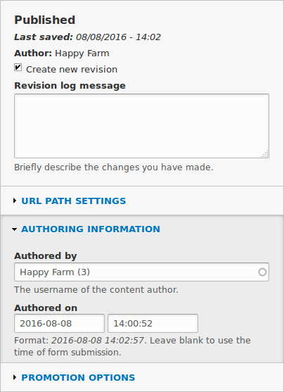
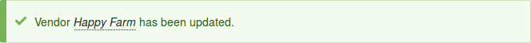

[[user-content]]

=== Asignación de autores al contenido

[role="summary"]
Cómo asignar la autoría de los elementos de contenido a una cuenta de usuario.

(((Author,assigning)))
(((Content,assigning author)))

==== Objetivo

Asignar los elementos de contenido Vendor Happy Farm y Sweet Honey a las
cuentas de usuario Vendor correspondientes, para que puedan editar sus propios
perfiles de Vendor en el sitio.

==== Conocimientos previos

* <<user-concept>>

==== Requisitos previos del sitio web

* El tipo de contenido Vendor debe existir y su sitio debe tener al menos dos
elementos de contenido Vendor. Ver <<structure-content-type>>,
<<structure-fields>> y <<content-create>>.

* Deben existir cuentas de usuario para al menos dos vendors. Ver
<<user-new-user>>.

==== Pasos

. En el menú administrativo _Manage_, vaya a _Content_ (_admin/content_).

. Busque el elemento de contenido Vendor Happy Farm en la lista. Si no está
visible de inmediato, puede filtrar la lista por _Published status_, _Content
type_ (Vendor), _Title_ o _Language_. Haga clic en _Edit_ en el elemento de
contenido Vendor al que quiera asignar un autor.

. En _Authoring information_, comience a escribir el nombre de usuario del
Vendor Happy Farm en el campo _Authored by_. El campo muestra los nombres de
usuario coincidentes. Seleccione el nombre de usuario del Vendor en la lista.
+
--
// Authoring information section of content edit page.

--

. Haga clic en _Save_.

. Recibirá una notificación de que el elemento de contenido Vendor se ha
actualizado.
+
--
// Confirmation message after content update.

--

. Siga estos pasos de nuevo para asignar el elemento de contenido Vendor Sweet
Honey a la cuenta de usuario Vendor Sweet Honey.

// ==== Expand your understanding

// ==== Related concepts

==== Vídeos

// Video from Drupalize.Me.
video::https://www.youtube-nocookie.com/embed/yx9u2SCgono[title="Assigning Authors to Content"]

//==== Additional resources

*Atribuciones*

Escrito por https://www.drupal.org/u/dianalakatos[Diána Lakatos] en
https://pronovix.com/[Pronovix].

Traducido por https://www.drupal.org/u/juancasantito[Juan Santovenia].
