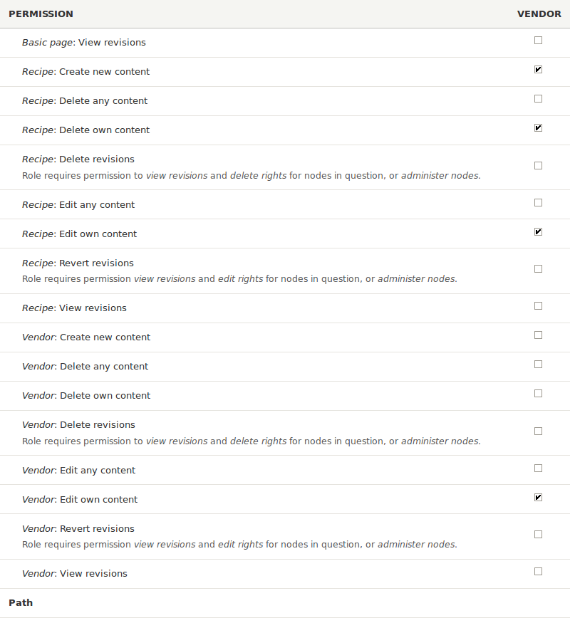

[[user-permissions]]
=== Asignación de permisos a un rol

[role="summary"]
Cómo asignar un permiso a un rol.

(((Permission,changing)))
(((Permission,granting)))
(((Permission,denying)))
(((Role,changing permission)))
(((Security,assigning permission)))

==== Objetivo

Cambiar los permisos del rol Vendor para que los usuarios puedan crear, editar
y eliminar contenido Recipe y Vendor, dar formato al contenido y ponerse en
contacto entre sí.

==== Conocimientos previos

* <<user-concept>>

==== Requisitos previos del sitio web

El rol Vendor debe existir en su sitio. Ver <<user-new-role>>.

==== Pasos

. En el menú administrativo _Manage_, vaya a _People_ > _Roles_
(_admin/people/roles_). Aparece la página _Roles_.

. Haga clic en _Edit permissions_ en el desplegable del rol Vendor. Aparece la
página _Edit role_, donde puede ver todas las acciones disponibles para el
sitio web como, por ejemplo, _Post comments_ o _Administer blocks_. Los
permisos disponibles dependen de los módulos que estén instalados en el sitio.
Nota: algunos permisos pueden tener implicaciones de seguridad. Sea prudente al
asignar permisos a los roles.

. Marque las casillas de los siguientes permisos, enumerados por módulo:
+
[width="100%",frame="topbot",options="header"]
|================================
| Module | Permission
| Contact | Use users' personal contact forms
| Filter | Use the Restricted HTML text format
| Node | Recipe: Create new content
| Node | Recipe: Edit own content
| Node | Recipe: Delete own content
| Node | Vendor: Edit own content
|================================
+
--
// Permissions page for Vendor (admin/people/permissions/vendor).

--

. Haga clic en _Save permissions_. Recibirá un mensaje indicando que sus
cambios se han guardado.
+
--
// Confirmation message after updating permissions.

--

==== Ampliar conocimiento

* Inicie sesión como uno de los nuevos usuarios que creó en <<user-new-user>>.
Compruebe si tiene los permisos correctos.

* <<user-roles>>

==== Conceptos relacionados

<<user-admin-account>>

==== Vídeos

// Video from Drupalize.Me.
video::https://www.youtube-nocookie.com/embed/IlVh9f4BHVw[title="Assigning Permissions to a Role"]

==== Recursos adicionales

https://www.drupal.org/docs/7/managing-users[_Drupal.org_ community documentation page "Managing Users"]

*Atribuciones*

Adaptado y editado por https://www.drupal.org/u/batigolix[Boris Doesborg],
https://www.drupal.org/u/bemery987[Brian Emery],
y https://www.drupal.org/u/jojyja[Jojy Alphonso] en
http://redcrackle.com[Red Crackle],
y https://www.drupal.org/u/eojthebrave[Joe Shindelar] en
https://drupalize.me[Drupalize.Me], de
https://www.drupal.org/docs/7/managing-users/user-roles["User Roles"],
copyright 2000-copyright_upper_year por los colaboradores individuales de la
https://www.drupal.org/documentation[Documentación de la Comunidad de Drupal].

Traducido por https://www.drupal.org/u/juancasantito[Juan Santovenia].
