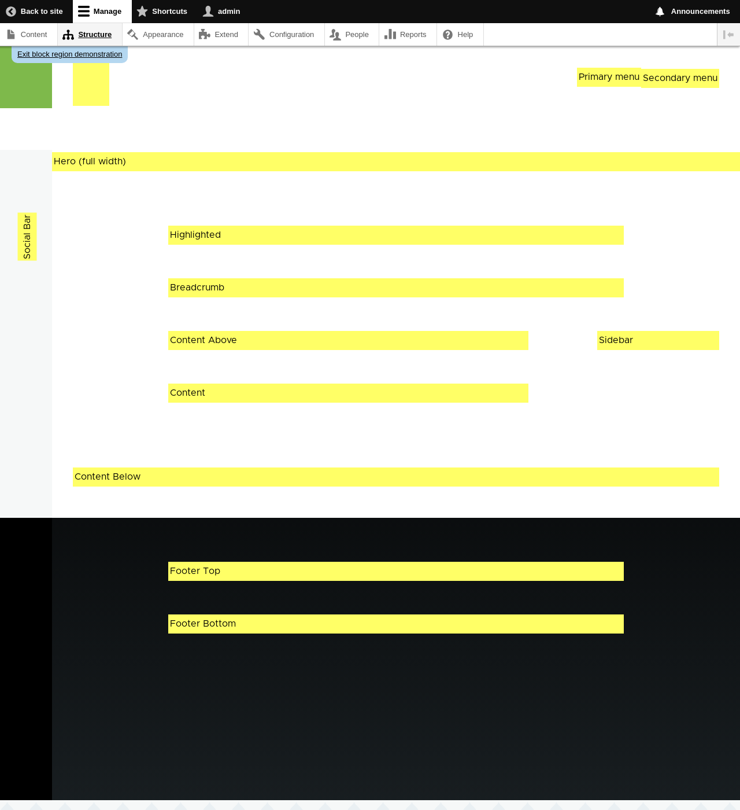

[[block-regions]]

=== Konsep: Wilayah dalam Tema

[role="summary"]
Gambaran umum wilayah dari perspektif pembuatan tema.

(((Tema,wilayah dalam)))
(((Tema Olivero,wilayah dalam)))
(((Wilayah,gambaran umum)))
(((Wilayah Breadcrumb,gambaran umum)))
(((Wilayah Content,gambaran umum)))
(((Wilayah Featured,gambaran umum)))
(((Wilayah Footer,gambaran umum)))
(((Wilayah Header,gambaran umum)))
(((Wilayah Help,gambaran umum)))
(((Wilayah Highlighted,gambaran umum)))
(((Wilayah Menu,gambaran umum)))
(((Wilayah Primary menu,gambaran umum)))
(((Wilayah Secondary menu,gambaran umum)))
(((Wilayah Sidebar,gambaran umum)))
(((Wilayah,breadcrumb)))
(((Wilayah,content)))
(((Wilayah,featured)))
(((Wilayah,footer)))
(((Wilayah,header)))
(((Wilayah,help)))
(((Wilayah,highlighted)))
(((Wilayah,menu)))
(((Wilayah,primary menu)))
(((Wilayah,secondary menu)))
(((Wilayah,sidebar)))

==== Pengetahuan prasyarat

<<understanding-themes>>

==== Apa itu wilayah?

Selain konten utama, halaman web berisi konten lain seperti merek situs
(nama situs, slogan, dan logo), alat bantu navigasi (menu, tautan, dan ikon),
teks diformat, serta gambar. Setiap tema menyediakan sekumpulan wilayah
bernama, seperti _Header_, _Content_, dan _Sidebar_, tempat pembuat situs dapat
memilih untuk menempatkan konten mereka.

Wilayah yang tersedia bergantung pada desain tema. Hanya wilayah Content, yang
berisi konten utama, yang wajib ada; wilayah lain bersifat opsional. Tema
Olivero inti menyediakan wilayah yang ditandai pada gambar berikut.

// Olivero theme region preview at admin/structure/block/demo/olivero,
// after configuring the theme for the Farmers Market scenario.

==== Topik terkait

* <<block-concept>>
* <<planning-data-types>>
* <<block-place>>

// ==== Additional resources

*Atribusi*

Ditulis dan disunting oleh https://www.drupal.org/u/jfmacdonald[John MacDonald],
https://www.drupal.org/u/michaellenahan[Michael Lenahan] di
https://erdfisch.de[erdfisch], serta
https://www.drupal.org/u/eojthebrave[Joe Shindelar] di
https://drupalize.me[Drupalize.Me].
