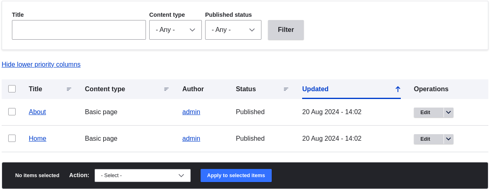
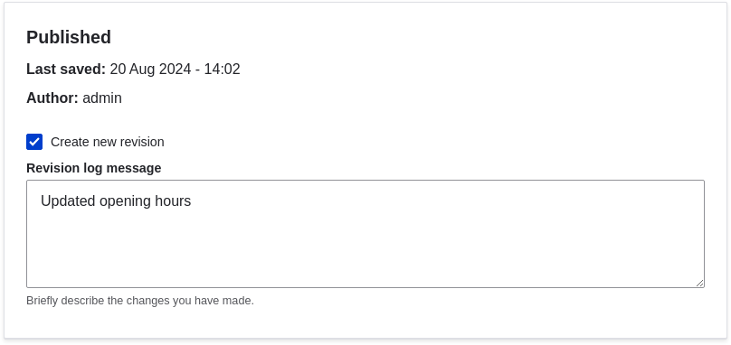

[[content-edit]]
=== Menyunting Item Konten

[role="summary"]
Cara menyunting item konten.

(((Konten,menyunting)))
(((Konten,menemukan)))
(((Menyunting konten)))

==== Tujuan

Memperbarui jam operasional pada item konten halaman Home.

==== Pengetahuan prasyarat

<<content-create>>

==== Prasyarat situs

Item konten untuk halaman Home harus sudah ada. Lihat <<content-create>>.

==== Langkah-langkah

. Dalam menu administratif _Kelola_, buka _Konten_ (_admin/content_).

. Jika item konten yang ingin Anda sunting baru saja diperbarui atau dibuat,
item tersebut seharusnya muncul di dekat bagian atas daftar konten pada halaman
itu. Jika tidak, Anda dapat menggunakan filter _Tipe konten_, _Judul_, atau
filter lain untuk menemukan item konten.
+
--
// Content list on admin/content, with filters above.

--

. Klik _Sunting_ pada baris item konten yang ingin Anda sunting (Home) untuk
membuka formulir penyuntingan konten. Perbarui jam operasional pada kolom _Isi_.
Lihat <<content-create>> untuk penjelasan tentang kolom dan tangkapan layar.

. Centang _Buat revisi baru_ di bawah _Diterbitkan_ jika belum dicentang, lalu
masukkan _Pesan log revisi_ yang menjelaskan perubahan yang Anda buat (misalnya,
Anda dapat memasukkan "Jam operasional diperbarui"). Teks ini akan muncul dalam
log revisi halaman.
+
--
// Revision area of the content edit page.

--

. Klik _Simpan_ untuk menyimpan perubahan Anda.

. Anda akan diarahkan kembali ke halaman administratif _Konten_, dan seharusnya
ada pesan yang menunjukkan bahwa item konten telah diperbarui.
+
--
// Updated content message.

--

==== Perluas pemahaman Anda

Sebagai alternatif untuk dua langkah pertama di atas, Anda juga dapat membuka
formulir penyuntingan konten sebagai berikut:

. Dari halaman beranda situs, gunakan menu navigasi situs untuk menemukan
halaman tempat konten yang ingin Anda sunting ditampilkan kepada pengunjung.

. Sebagian besar tema akan menampilkan tautan atau tab _Sunting_ di dekat bagian
atas halaman tersebut kepada orang yang memiliki izin untuk menyunting halaman;
mengklik tautan tersebut akan membawa Anda ke formulir penyuntingan konten
lengkap.

//==== Related concepts

==== Video

// Video from Drupalize.Me.
video::https://www.youtube-nocookie.com/embed/TAFZMcuOqG0[title="Menyunting Item Konten"]

//==== Additional resources

*Atribusi*

Ditulis oleh https://www.drupal.org/u/chris-dart[Chris Dart] dan
https://www.drupal.org/u/jhodgdon[Jennifer Hodgdon].
